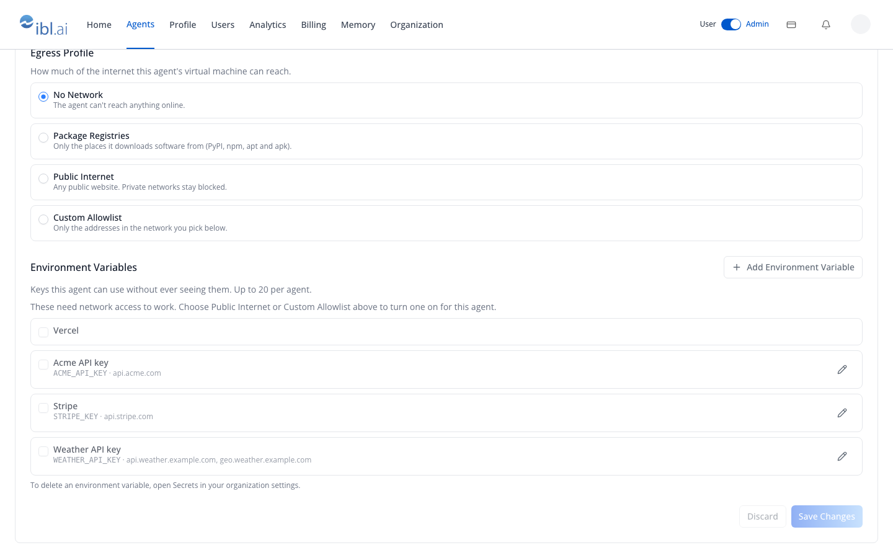
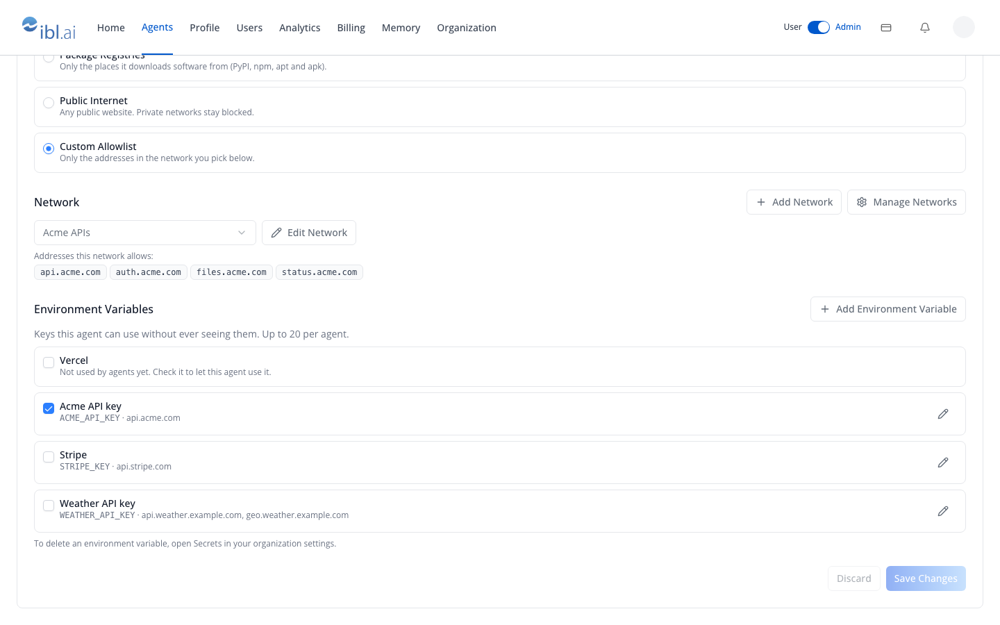
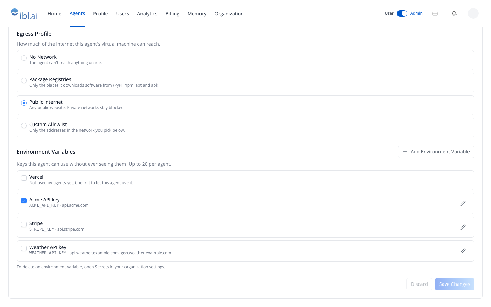
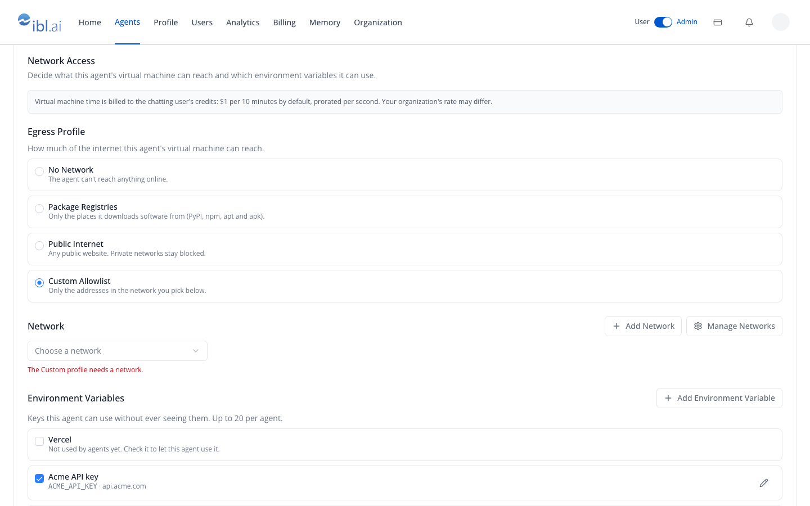
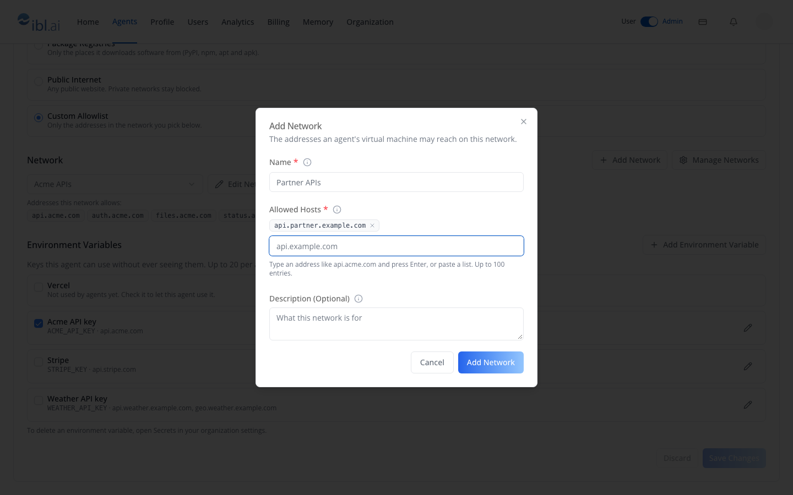
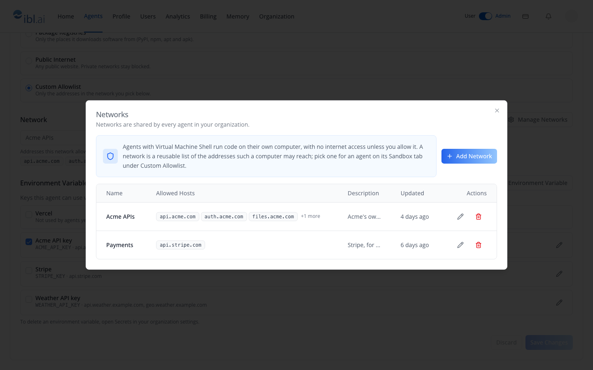
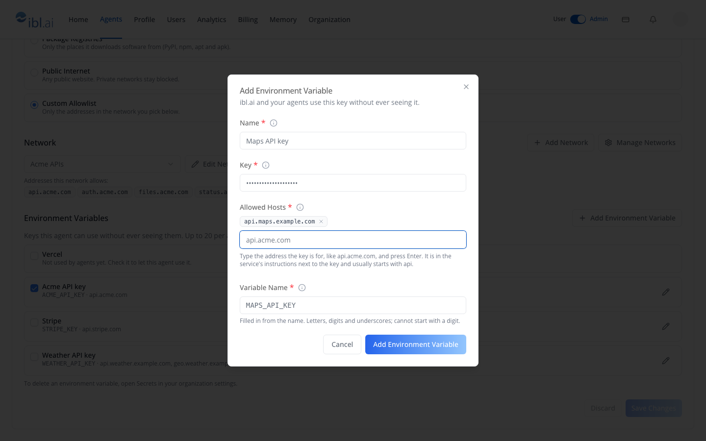
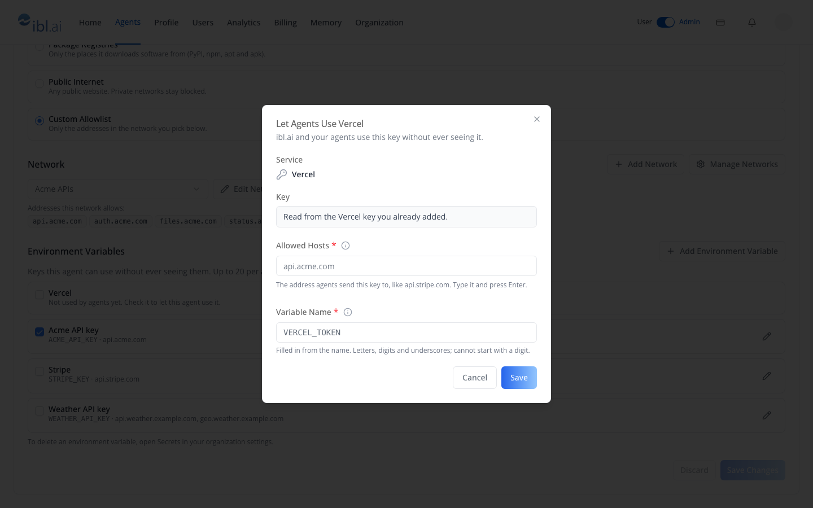

# iblai-vibe-agent-virtual-machine

> Add the agent Sandbox "Network Access" section for the Virtual Machine Shell — the egress profile radio group (No Network, Package Registries, Public Internet, Custom Allowlist), the network picker with Add, Edit and Manage Networks, the environment variables this agent may use (added in place, or a Services key switched on for agents), and the VM billing notice. Use this when an agent runs code in a virtual machine and you need to decide what it can reach and which keys it can use. For the sandbox type selector and Claw instances see /iblai-vibe-agent-sandbox; for the organization's networks and environment variables see /iblai-vibe-virtual-machine

# /iblai-vibe-agent-virtual-machine

Add the agent Sandbox **Network Access** section -- "Decide what this
agent's virtual machine can reach and which environment variables it can
use." It renders under the Sandbox Type card while **Virtual Machine Shell**
is the selected kind, and it holds three controls plus a billing notice:

- **Egress Profile** — No Network (the default), Package Registries,
  Public Internet, Custom Allowlist.
- **Network** — required under Custom Allowlist; a picker over the
  organization's networks with **Add Network**, **Edit Network** and
  **Manage Networks**, and the chosen network's addresses listed below it.
- **Environment Variables** — under every profile: a checkbox list of the
  organization's environment variables (keys the VM can use by name but
  never read), capped at 20 per agent, with **Add Environment Variable**.
  They only work with network access, so under No Network and Package
  Registries the boxes are greyed out.

The networks and environment variables are organization-wide records — see
`/iblai-vibe-virtual-machine`. This section turns them on for one agent,
and adds new ones without leaving the agent.

















> **Common setup (brand, conventions, env files, verification):** see [docs/skill-setup.md](https://raw.githubusercontent.com/iblai/vibe/refs/heads/main/docs/skill-setup.md).

## Related surfaces

- **`/iblai-vibe-agent-sandbox`** — the Sandbox tab itself: the
  **Sandbox Type** card (Computing Runtime / Virtual Machine Shell /
  Claw) and, for Claw, instance management and the prompt files.
  `SandboxConfig` mounts this section for you.
- **`/iblai-vibe-virtual-machine`** — the organization's **Network** page
  and **Secrets → Environment Variables** tab behind the pickers here.
  Deleting an environment variable happens there, not here.
- **`/iblai-vibe-account`** — **Secrets → Services**, where keys such as
  Stripe's are added before an agent can use them.

## Prerequisites

- Auth must be set up first (`/iblai-vibe-auth`)
- MCP server + skills configured (`@iblai/mcp` in `.mcp.json`)
- `@iblai/iblai-js@^2.68.1` (resolves `@iblai/web-containers` 1.68.1):
  earlier releases call these "network policies" and "secrets", show
  secrets only under Public Internet and Custom Allowlist, and add them
  only through a **Manage Secrets** popup.
- Ask the user for a real `mentorId` (agent UUID). Do NOT invent one.
- The agent must have **Virtual Machine Shell** selected
  (`enable_virtual_machine: true`) — see `/iblai-vibe-agent-sandbox`.
  Nothing here applies to the Computing Runtime or Claw kinds.
- The viewer needs the `Ibl.Mentor/VirtualMachineNetworkPolicies/list`
  and `Ibl.Mentor/VirtualMachineSecrets/list` permissions to see the
  network picker and the environment variables; each hides independently
  on a 403.

## Step 1: Check Environment

Before proceeding, check for an `iblai.env` in the project root. Look for
`PLATFORM`, `DOMAIN`, and `TOKEN` variables. If the file does not exist or
is missing these variables, tell the user:
"You need an `iblai.env` with your platform configuration. Download the
template and fill in your values:
`curl -o iblai.env https://raw.githubusercontent.com/iblai/vibe/refs/heads/main/iblai.env`"

## Step 2: Mount it

**You usually mount nothing.** `SandboxConfig` renders
`VirtualMachineNetworkSection` itself whenever the agent's
`enable_virtual_machine` flag is on, so following
`/iblai-vibe-agent-sandbox` Step 2 already gives you this section.

Mount it standalone only when you build your own sandbox page:

```tsx
// app/(app)/agents/[mentorId]/network/page.tsx
"use client";

import { useParams } from "next/navigation";
import { VirtualMachineNetworkSection } from "@iblai/iblai-js/web-containers";

export default function AgentNetworkPage({
  platformKey,
  username,
}: {
  platformKey: string;
  username: string;
}) {
  const { mentorId } = useParams<{ mentorId: string }>();

  return (
    <div className="flex flex-1 flex-col bg-white p-6">
      <VirtualMachineNetworkSection
        platformKey={platformKey}
        mentorUniqueId={mentorId}
        username={username}
      />
    </div>
  );
}
```

The component owns its own data: it reads the agent settings, the
organization's networks, environment variables and Services keys, keeps a
local draft, and saves through **Save Changes** / **Discard**. It does not
read `AgentSettingsProvider`, and it does **not** check
`enable_virtual_machine` — gate the mount yourself if you render it
outside `SandboxConfig`.

## Step 3: Use MCP Tools for Customization

```
get_component_info("VirtualMachineNetworkSection")
get_component_info("SandboxConfig")
get_hook_info("useListVirtualMachineNetworkPoliciesQuery")
```

## Component Props

### `<VirtualMachineNetworkSection>` — `@iblai/iblai-js/web-containers`

| Prop | Type | Required | Description |
|------|------|----------|-------------|
| `platformKey` | `string` | Yes | Organization key (org slug) |
| `mentorUniqueId` | `string` | Yes | Agent UUID |
| `username` | `string` | Yes | Signed-in admin — the mentor-settings path segment, and the agent-name lookup when a network delete is refused |

## What the section renders

### Billing notice

A grey note above the controls: *"Virtual machine time is billed to
the chatting user's credits: $1 per 10 minutes by default, prorated
per second. Your organization's rate may differ."* The figures come
from `VIRTUAL_MACHINE_DEFAULT_BILLING` (`{ usd: 1, minutes: 10 }`);
the real rate is configurable per organization.

### Egress Profile

Four radio cards, each with a label and one line of explanation:

| Profile | Wire value | Reachability |
|---|---|---|
| No Network | `none` (default) | The VM cannot reach anything |
| Package Registries | `registries` | PyPI, npm, apt and apk only, for installing software |
| Public Internet | `public` | Any public website; private networks, localhost and cloud metadata stay blocked |
| Custom Allowlist | `custom` | Only the addresses in the network picked below |

### Network (Custom Allowlist only)

- A **select** ("Choose a network") over the organization's networks,
  plus **Add Network** (opens the Add Network dialog in place and selects
  the new network on save), **Edit Network** (the same dialog for the
  current choice) and **Manage Networks**.
- Below the select, **"Addresses this network allows:"** with the
  network's addresses as chips.
- With nothing picked, *"The Custom profile needs a network."* shows in
  red and **Save Changes** stays disabled.
- Empty organization → the select reads *"No networks yet"* and is
  disabled; use **Add Network**.
- No list permission → the whole picker is replaced by a line saying the
  profile cannot be configured from here.
- **Manage Networks** opens a popup titled **Networks** ("Networks are
  shared by every agent in your organization.") holding the same
  `VirtualMachineAdminTab` as the organization's Network page.

### Environment Variables (every profile)

- *"Keys this agent can use without ever seeing them. Up to 20 per
  agent."*
- First, each Services key no agent uses yet (Stripe, Vercel, …), with
  *"Not used by agents yet. Check it to let this agent use it."* Checking
  it opens **Let Agents Use {name}**: the service and a read-only Key line
  ("Read from the {name} key you already added."), **Allowed Hosts**
  (filled in for Stripe, ElevenLabs and HeyGen) and **Variable Name**
  (`VERCEL_TOKEN`). Save creates the environment variable, and the row
  becomes an ordinary one.
- Then one checkbox per environment variable: its name, then
  `VARIABLE · addresses`, and a pencil that opens **Edit Environment
  Variable**.
- **Add Environment Variable** opens the dialog straight on Name, Key,
  Allowed Hosts and Variable Name. Under Public Internet or Custom
  Allowlist the new one is turned on for this agent at once; when that is
  the only unsaved change (and, under Custom Allowlist, the network
  already allows its addresses) it is saved too — *"{name} added and
  turned on for this agent"* — otherwise a line says to click **Save
  Changes**. Under No Network or Package Registries it is added but not
  turned on.
- Under No Network and Package Registries the checkboxes are disabled
  and one line says to choose Public Internet or Custom Allowlist; the
  button and the pencils still work.
- At 20 turned on, the rest disable and a note says the cap is reached.
- None in the organization → *"No environment variables yet. Click Add
  Environment Variable to add one."*
- Under the list: *"To delete an environment variable, open Secrets in
  your organization settings."*
- No list permission → the whole block is hidden.

## Rules the section enforces before saving

These mirror the backend; getting them wrong is a 400.

| Situation | What happens |
|---|---|
| Custom Allowlist with no network | Save disabled, inline red message |
| Moving to No Network / Package Registries while variables are on | A **Remove Environment Variables?** dialog; **Remove and Save** sends `virtual_machine_secret_ids: []` in the same request |
| A variable that is on is sent to an address the chosen network does not allow | An amber panel lists each one ("Acme API key is sent to api.acme.com, which Acme APIs doesn't allow."), with **Add Hosts to {network} and Save** — one PATCH on the network, then the settings save |
| More than 20 variables | Not reachable; the checkboxes disable at the cap |
| Backend 400 | Field errors land under the matching control (`virtual_machine_egress`, `virtual_machine_network_policy_id`, `virtual_machine_secret_ids`); anything else becomes a form-level message |
| Backend 403 on save | "You do not have permission to change these settings." |

Only the keys that actually changed are sent, and the save goes
through `useEditMentorJsonMutation` — **not** the multipart
`useEditMentorMutation`, which drops an empty list and a `null`, so
"turn every variable off" and "clear the network" would never reach the
backend. Mirror that choice in custom UI.

## Agent settings fields

Read from `GET`, written with `PUT` on
`${dmUrl}/api/ai-mentor/orgs/{org}/users/{username}/mentors/{mentor_unique_id}/settings/`
(a partial update — send only what changes).

| Field | Read shape | Write shape |
|---|---|---|
| `virtual_machine_egress` | `"none" \| "registries" \| "public" \| "custom"` | same |
| `virtual_machine_network_policy` | `{ id, name, allowed_hosts }` or `null` | written as `virtual_machine_network_policy_id: number \| null` |
| `virtual_machine_secrets` | `[{ id, name, env_var, allow_hosts, source_credential_id }]` | written as `virtual_machine_secret_ids: number[]` — replaces the whole set, `[]` turns all off |

The backend binds environment variables only to an agent with network
access (`public` or `custom`). The network and environment variable
endpoints themselves are documented in `/iblai-vibe-virtual-machine`.

## Related Exports

From `@iblai/iblai-js/web-containers`:

- `VirtualMachineNetworkSection`, `VirtualMachineNetworkSectionProps` —
  this section.
- `SandboxConfig` — the Sandbox tab that mounts it (see
  `/iblai-vibe-agent-sandbox`).
- `VirtualMachineAdminTab` — what **Manage Networks** renders inside the
  popup.
- `HostPortChipInput`, `HostPortChipInputProps` — the address chip
  input both dialogs use; reusable for any allowlist field.

From `@iblai/iblai-js/data-layer`:

- `useGetMentorSettingsQuery`, `useEditMentorJsonMutation` — read and
  write the three agent fields above.
- `useListVirtualMachineNetworkPoliciesQuery`,
  `useUpdateVirtualMachineNetworkPolicyMutation` — the picker's
  options and the "add the missing hosts" PATCH.
- `useListVirtualMachineSecretsQuery`,
  `useCreateVirtualMachineSecretMutation` — the checkboxes, and a variable
  added or linked from here.
- `useGetIntegrationCredentialsQuery`,
  `useGetIntegrationCredentialsSchemaQuery` — the Services keys listed as
  "Not used by agents yet".
- `VIRTUAL_MACHINE_EGRESS_PROFILES`,
  `VIRTUAL_MACHINE_MAX_SECRETS_PER_MENTOR` (20),
  `VIRTUAL_MACHINE_DEFAULT_BILLING` (`{ usd: 1, minutes: 10 }`) — the
  constants the UI is built from.
- `isVirtualMachineEgressNetworked` — true for `public` and `custom`
  (the profiles whose environment variables work).
- `findUncoveredSecretHosts` — the variable-vs-network check behind
  the amber panel.
- `getVirtualMachineApiError`, `getVirtualMachineErrorStatus` —
  normalise a 400 into `{ message, fieldErrors }` and read the status
  off an RTK Query error.
- Types: `VirtualMachineEgress`, `MentorVirtualMachineSettings`,
  `MentorVirtualMachineSettingsUpdate`, `VirtualMachineNetworkPolicy`,
  `VirtualMachineSecret`, `VirtualMachineUncoveredSecretHosts`.

SDK source: `packages/web-containers/src/components/claw-sandbox/virtual-machine-network-section.tsx`,
with the shared dialogs under `components/virtual-machine/` and the data
layer under `packages/data-layer/src/features/virtual-machine/`.

## Step 4: Verify

Run `/iblai-vibe-ops-test` before telling the user the work is ready, and give
every page, control and state this skill added its own checkpoint — one Playwright
test titled `<ID> · …` in `e2e/journeys/`, listed in `e2e/coverage.json`;
`pnpm e2e:coverage` must pass:

1. `pnpm build` -- must pass with zero errors
2. `pnpm test` -- vitest must pass
3. Touch test `/agents/<id>/sandbox` in the browser as `/iblai-vibe-ops-test` says: open it,
   use every control this skill added, read the console, check the phone width.

## Important Notes

- **Redux store**: Must include `mentorReducer` and `mentorMiddleware`
  (they register `virtualMachineApiSlice`)
- **`initializeDataLayer()`**: 5 args (v1.2+)
- **`@reduxjs/toolkit`**: Deduplicated via webpack aliases in `next.config.ts`
- **Peer deps**: `sonner` and `@iblai/iblai-web-mentor` must be installed
  (`pnpm add sonner @iblai/iblai-web-mentor`)
- **No network is the default.** A new agent on Virtual Machine Shell
  reaches nothing until someone picks a profile here. Treat that as
  the feature, not a gap.
- **Environment variables are for the VM, not the agent.** Inside the
  machine the variable holds a placeholder; the real key is substituted
  only on TLS requests to its `allow_hosts`. The agent never sees it, and
  no endpoint ever returns it.
- **Environment variables need a networked profile.** They are listed
  under every profile but can only be turned on under Public Internet and
  Custom Allowlist, and moving away from those turns them off — with a
  confirmation first.
- **Two independent 403s.** The network picker and the Environment
  Variables block gate on their own list permission. One can be visible
  while the other is not; the save itself can still 403 separately.
- **Networks are shared.** Editing a network from here changes it for
  every agent that uses it, and the edit dialog warns when you remove an
  address an environment variable still needs.
- **`mentorUniqueId` vs `mentorId`**: these endpoints key on the
  agent's UUID, not the integer pk — the same UUID as the rest of the
  agent-* family.
- **Brand guidelines**: [BRAND.md](https://raw.githubusercontent.com/iblai/vibe/refs/heads/main/BRAND.md)