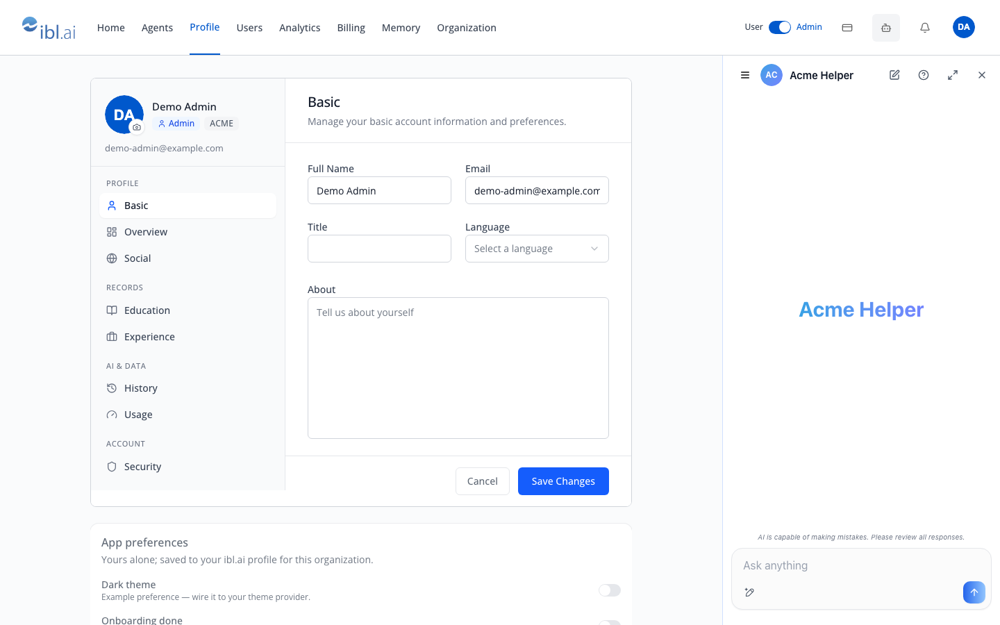
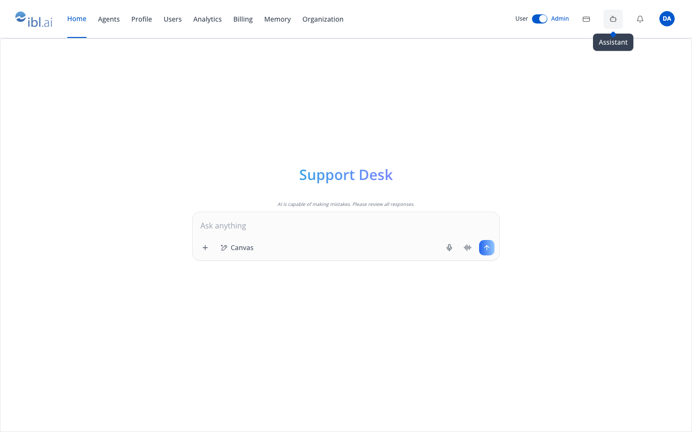
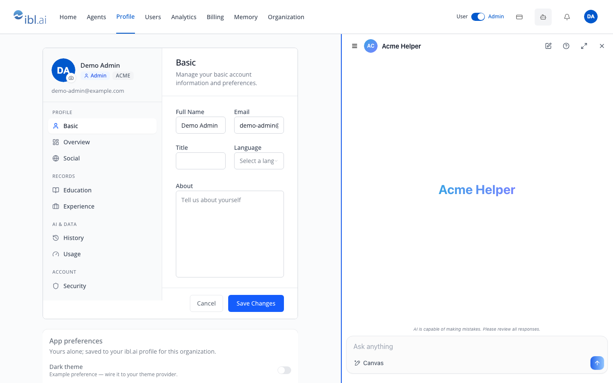
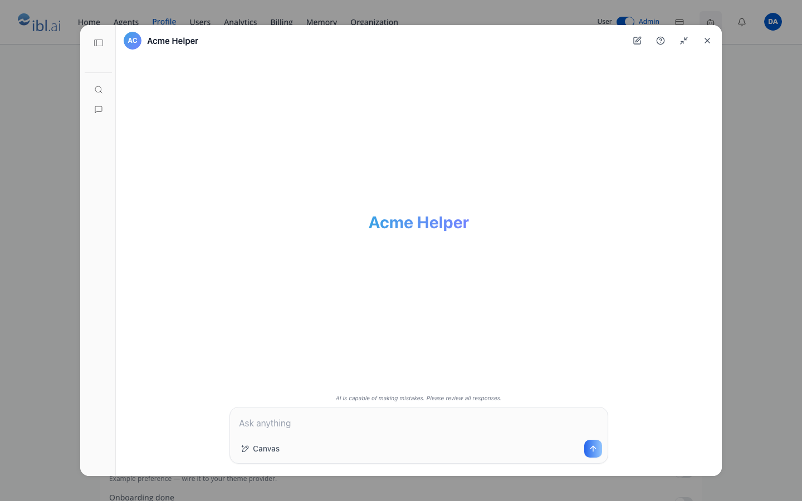
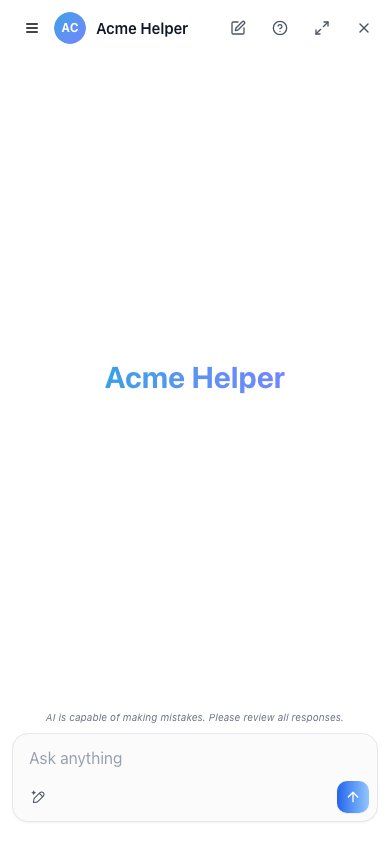

# /iblai-vibe-agent-assistant

The **Assistant** keeps an agent one click away on every page of your app.
A robot button in the header opens the organization's Default Agent in a
column beside the page: the page makes room for it, the user drags its edge
to change its width, switches it to full screen, or closes it, and the
conversation stays while they move between pages. It is the same feature
the ibl.ai app puts in its header, built from three SDK components.



> **Common setup (brand, conventions, env files, verification):** see
> [docs/skill-setup.md](https://raw.githubusercontent.com/iblai/vibe/refs/heads/main/docs/skill-setup.md).

## What you get

- **The header button** (`MasterAgent`): lucide's Bot, the same size and
  grey as the bell beside it; its tooltip and accessible name are
  *Assistant*.
- **The panel** (`MasterAgentPanel`): the agent's chat, the `<agent-ai>`
  embed of the ibl.ai app, docked beside the page.
- **The state** (`MasterAgentProvider`): which agent, open or closed, full
  screen or docked, and the width.
- `components/assistant/assistant-provider.tsx` (shipped): the provider
  with vibe-starter's sign-in, organization and the hosted ibl.ai app.
- vibe-starter does not ship the Assistant; Steps 1–4 add it.

## What people see

**The button.** It appears once there is an agent to open. On hover the
antenna waves and the eyes blink, unless the system asks for reduced
motion. While the panel is open the button stays pressed.



**Docked.** A click opens the agent as a column flush under the header and
against the window's right edge, 400 px wide the first time. The page
narrows to make room; nothing is covered.

**Resizing.** Drag the panel's left edge (it turns blue), or focus it and
press the arrow keys (24 px a step). The width runs from 320 px to
1200 px and always leaves the page 320 px. It is remembered on that device.



**Full screen.** The embed's own **Full screen** button turns the panel
into a popup over the dimmed page, with the embed's sidebar beside the
chat. **Exit full screen** docks it again. While the popup is
open, the page behind it is out of reach for the keyboard and screen
readers.



**Close.** The embed's **Close chat** hides the panel and puts focus back
on the header button. The chat stays loaded: the next click shows the same
conversation.

**Phones.** Below 768 px the panel covers the screen, with no drag edge;
**Close chat** returns to the page.



### Which agent it opens

1. The organization's **Default Agent**, set by an admin in Account →
   **Advanced** → Default Agent (`/iblai-vibe-account`). It is skipped once
   that agent no longer exists.
2. Else the older Skills setting, `skills_embedded_mentor_name`.
3. Else the agent the user starred.
4. Else the agent they used last.

The organization's settings come from the user's organization list, which
the app fetches and saves when it loads, so a new Default Agent shows after
a reload. Pass `agentId` to open one agent instead.

## When to use / when not

| Use it for | Not for |
|---|---|
| A helper beside every page: questions about the app, a copilot over your own screens | The app's main chat page, rendered in-process: `/iblai-vibe-agent-chat` |
| The organization's own Default Agent, chosen by its admins | Putting an agent on another website: `/iblai-vibe-agent-embed`, `/iblai-api-agent-embed` |

## Prerequisites

- Auth in place (`/iblai-vibe-auth`, or vibe-starter).
- `@iblai/iblai-js@^2.85.1` (resolves `@iblai/web-containers` 1.81.1; the
  Assistant arrived in 1.81.0) and `@iblai/agent-ai` 2.14.0 or later (full
  screen). vibe-starter ships both (`@iblai/agent-ai@^2.15.1`).
- An agent to open: a Default Agent for the organization, or one the user
  starred or used. To pin one, ask the user for its real UUID; never invent
  one.
- The page must be allowed to frame the ibl.ai app. vibe-starter's CSP
  (`applyCsp` in `middleware.ts`) already allows `https://*.iblai.app` and
  `https://*.ibl.ai`. On a self-hosted domain, add the app's origin:
  `applyCsp(request, { requestHeaders, frameSrc: ["https://mentorai.<domain>"] })`.

## Step 1: Add the provider

Copy [`assets/assistant-provider.tsx`](assets/assistant-provider.tsx) to
`components/assistant/assistant-provider.tsx`. It renders
`MasterAgentProvider` with:

| Prop | Value | Why |
|---|---|---|
| `tenant`, `username` | the signed-in session | the agent lookup and the embed's organization |
| `authUrl`, `lmsUrl` | `config.authUrl()`, `config.legacyLmsUrl()` | where the embed renews or sends a signed-out user |
| `mentorUrl` | `https://mentorai.${config.platformBaseDomain()}` | where the embed loads the agent: the hosted ibl.ai app (os.ibl.ai on `iblai.app`). The SDK's default is the page's own origin, which is right only inside the ibl.ai app, since vibe-starter has no `/platform/…` embed page |
| `agentId` | yours, or left out | left out, the lookup above picks the agent |
| `enabled` | signed in, and not `?embed=true` | signed out or embedded, it looks nothing up and shows nothing |

The embed is signed in as your app's user: the SDK sets `authRelyOnHost`,
so `<agent-ai>` hands the session your SSO stored to the frame instead of
sending the user to the login page.

## Step 2: Wrap the shell and dock the panel

In `app/(app)/layout.tsx`, wrap the header and the page in the provider,
and put `MasterAgentPanel` in a row beside `<main>`:

```tsx
import { MasterAgentPanel } from '@iblai/iblai-js/web-containers';
import { AssistantProvider } from '@/components/assistant/assistant-provider';

// …inside AdminModeProvider, around the whole h-screen column:
<AssistantProvider tenantKey={tenantKey} username={username}>
  <div className="flex h-screen flex-col overflow-hidden bg-white">
    <NavBar … />
    {/* … drawer, CreditExhaustionHandler … */}

    {/* The page and the Assistant side by side: the page makes room for it. */}
    <div className="flex min-h-0 flex-1">
      <main className="flex min-h-0 min-w-0 flex-1 flex-col overflow-y-auto bg-[var(--sidebar-bg,#fafbfc)]">
        {children}
      </main>
      <MasterAgentPanel />
    </div>
  </div>
</AssistantProvider>
```

- The provider sits above every page, so the panel stays open, at its
  width, while the user moves between pages.
- `min-w-0` on `<main>` lets the page narrow beside the panel.
- `MasterAgentPanel` takes a `className` for its docked view. The ibl.ai
  app passes `md:-mt-4` to cancel its header's bottom margin; vibe-starter's
  header has none, so it needs nothing.

## Step 3: Put the button in the header

In `components/navbar/nav-bar.tsx`, add `MasterAgent` to the right-hand
group, before the notifications bell (the ibl.ai app's order: credits,
Incognito, Assistant, notifications, profile):

```tsx
import {
  CreditBalance,
  MasterAgent,
  NotificationDropdown,
  isPlatformNavbarCreditBalanceVisible,
} from '@iblai/iblai-js/web-containers';

// …after CreditBalance:
{/* The Assistant: renders once there is an agent to open. */}
<MasterAgent />
```

It renders nothing outside the provider, while `enabled` is false, or
before an agent is known, so it needs no condition of its own.

## Step 4: Let pages make room

- **Page widths.** A page sized from the window does not shrink beside the
  panel and runs under it. vibe-starter's `agents`, `profile`, `account` and
  `notifications` pages (and pages copied from `/iblai-vibe-component`'s
  pattern) use `md:w-[75vw]`. Change it to `md:w-3/4`: the same width with
  the panel closed, three quarters of what is left with it open.
- **Controls pinned to the right edge.** The docked panel publishes its
  width as `--master-agent-inset` on `<html>`. Step a fixed button left of
  it the way the ibl.ai app moves its accessibility button:
  `md:right-[calc(1rem+var(--master-agent-inset,0px))]`. The SDK's canvas
  controls already do.

## Verify

1. `pnpm build` and `pnpm test` pass.
2. Touch test as `/iblai-vibe-ops-test` says, signed in, in an organization
   with a Default Agent:
   - the robot button shows in the header, with the tooltip *Assistant*;
   - a click docks the agent under the header and the page narrows; no page
     runs under the panel;
   - dragging the left edge, and the arrow keys on it, change the width,
     which survives a reload;
   - **Full screen** opens the popup over the dimmed page; **Exit full
     screen** docks it again;
   - **Close chat** hides it and focus returns to the button; reopening
     shows the same conversation;
   - at phone width the panel covers the screen;
   - the console shows no CSP `frame-src` refusal.

## Customize

```
get_component_info("MasterAgentProvider")
get_component_info("MasterAgentPanel")
```

| Component | Prop | Type | Description |
|---|---|---|---|
| `MasterAgentProvider` | `tenant` | `string` | Organization the agent runs in |
| | `username` | `string` | Finds the user's starred or most recent agent |
| | `authUrl` | `string` | Auth app the embed sends a signed-out visitor to |
| | `lmsUrl?` | `string` | LMS host the embed renews the sign-in through |
| | `mentorUrl?` | `string` | Where the embed loads the agent. Default: the page's origin |
| | `agentId?` | `string` | Opens this agent instead of the lookup |
| | `enabled?` | `boolean` | `false` looks nothing up and shows nothing. Default `true` |
| `MasterAgent` | `className?` | `string` | On the header button |
| `MasterAgentPanel` | `className?` | `string` | On the docked panel, not the popup |

The two strings, *Assistant* and the drag edge's *Resize Assistant*, are
`masterAgent.title` and `masterAgent.resize` in the web-containers catalog
(en, es, fr, zh). The saved width is `ibl-master-agent-width` in
`localStorage`.

## Linked SDK exports

From `@iblai/iblai-js/web-containers` (the root entry, not `/next`):

- `MasterAgentProvider` + `MasterAgentProviderProps` — the state; wrap the
  header and the row.
- `MasterAgent` + `MasterAgentProps` — the header button.
- `MasterAgentPanel` + `MasterAgentPanelProps` — the docked panel, its drag
  edge (`role="separator"`) and the popup.

The panel imports `@iblai/agent-ai` (`<agent-ai>`) the first time it opens.
From `@iblai/iblai-js/web-utils`: `useEmbedMode` and `isLoggedIn`, which the
shipped provider uses for `enabled`.

## Platform data

| Call | Purpose |
|---|---|
| `GET /dm/api/core/users/platforms/` (via the SDK's saved organization list) | Each organization's metadata, holding the Default Agent (`overall_default_mentor`) |
| `useGetMentorPublicSettingsQuery` → `GET …/mentors/{agent}/public-settings/` | Checks the Default Agent still exists |
| `useGetRecentlyAccessedMentorsQuery` → `GET …/recently-accessed-mentors/` | The starred and last-used agents |
| `https://mentorai.<domain>/platform/{org}/{agent}?embed=true&show-close-button=true&allow-fullscreen=true` | The chat in the panel; its own calls go to the platform as the user |

REST reference: [org](https://raw.githubusercontent.com/iblai/vibe/refs/heads/main/skills/organizations/iblai-api-org/SKILL.md)
(the Default Agent), [agent embed](https://raw.githubusercontent.com/iblai/vibe/refs/heads/main/skills/agents/iblai-api-agent-embed/SKILL.md)
(`<agent-ai>` and the messages it posts).

## Security

- `<agent-ai>` hands the frame the session your app stored, so set
  `mentorUrl` only to the ibl.ai app (hosted, or your own self-hosted
  copy). Never to an address a user or a setting can change.
- The panel acts only on the full-screen and close messages from its own
  frame; messages from any other window are ignored.
- The framed app keeps its own chat key (`session_id:framed`) only when it
  shares the page's origin, as in the ibl.ai app. On a vibe app the frame is
  another origin, so the page's chat and the Assistant's never mix.

## Related skills

- `/iblai-vibe-agent-chat` — the in-process chat the home page shows.
- `/iblai-vibe-account` — the Advanced tab where admins pick the Default Agent.
- `/iblai-vibe-navbar` — the header the button goes in.
- `/iblai-vibe-agent-embed`, `/iblai-api-agent-embed` — the same `<agent-ai>`
  embed on other websites.
- `/iblai-vibe-component` — the page layout convention Step 4 adjusts.
