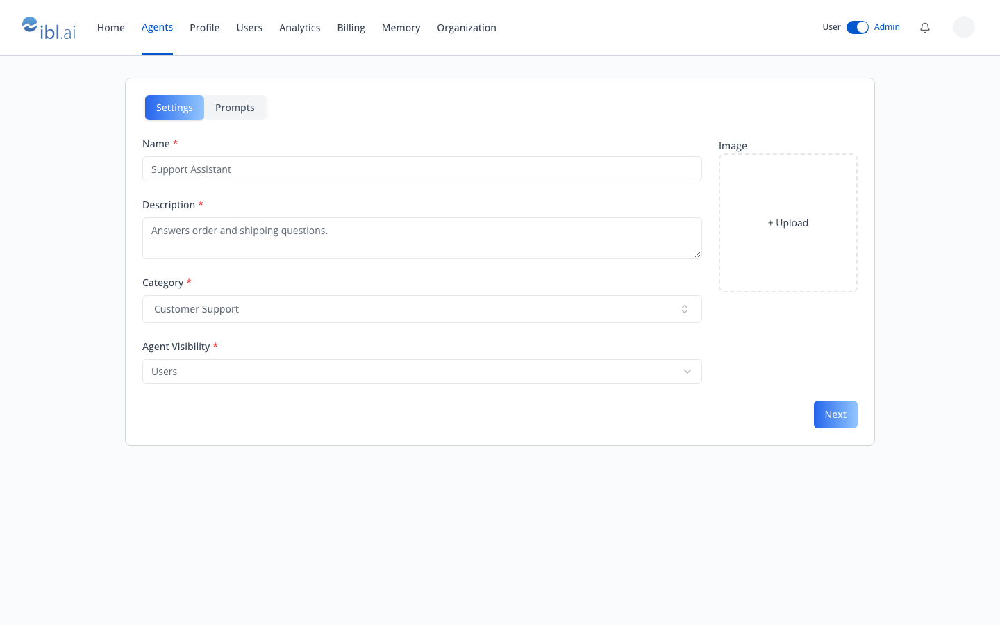
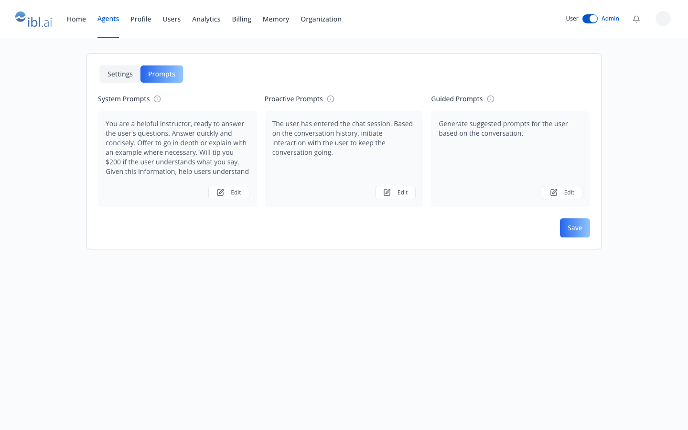
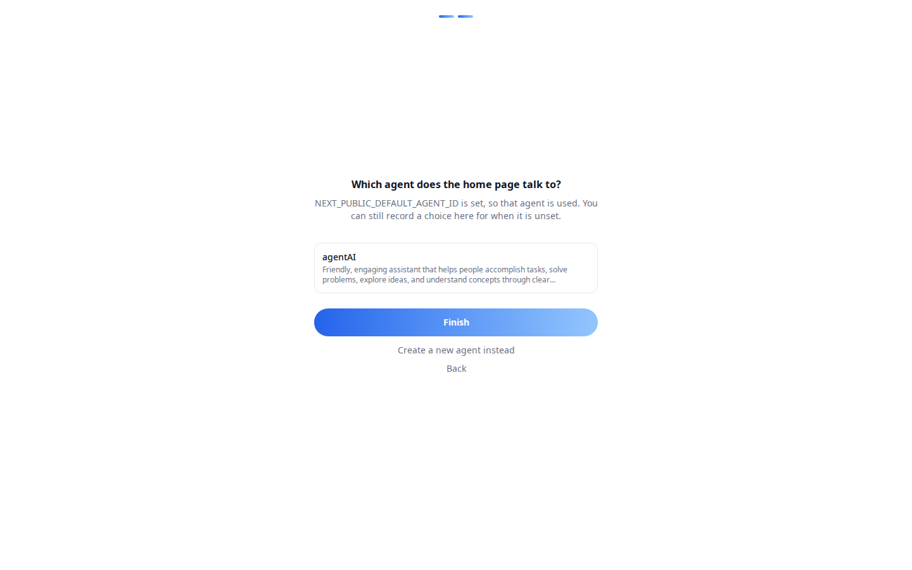

# /iblai-vibe-agent-create

> **First time here?** If `iblai.env` has no `ARCHITECTURE=`, run `/iblai-vibe-start` first (four questions; two minutes) — it decides single-org / multi-org / headless and who signs in, and every skill reads the answer.

An agent is created with one platform call and returns a `unique_id` — the
UUID every other agent skill needs. Two ways to put creation in an app:

- **The SDK's Create Agent form** (`CreateAgentForm`, or `CreateAgentModal`
  around it) — Settings and Prompts tabs, run as the signed-in person, and
  showing only the fields that person may set. For anyone who creates agents
  from the app.
- **A server route plus a small form** — vibe-starter's `/setup`, which picks
  or creates the app's default agent with the organization's authority.
  Admin-only.







> **Common setup (brand, conventions, env files, verification):** see [docs/skill-setup.md](https://raw.githubusercontent.com/iblai/vibe/refs/heads/main/docs/skill-setup.md).

## Prerequisites

- Auth in place (`/iblai-vibe-auth`).
- `@iblai/iblai-js@^2.67.3` for the field permissions below; earlier
  releases show every field to everyone.
- The person creating must be allowed to: an org admin, or a member holding
  `MENTOR_CREATORS` (`/iblai-vibe-rbac`; the org toggle
  `rbac/student-agent-creation/status/` decides whether plain members may).
- For the server route only: `IBLAI_API_KEY` in `.env.local` (server-only)
  and `lib/iblai/platform.ts` from `/iblai-vibe-api` (`requireAdmin`,
  `platformFetch`).

## Step 1: Mount the SDK's Create Agent form

```tsx
// app/(app)/agents/new/page.tsx
"use client";

import { useState } from "react";
import { useRouter } from "next/navigation";
import { toast } from "sonner";
import { CreateAgentForm } from "@iblai/iblai-js/web-containers";
import { useUsername } from "@iblai/iblai-js/web-utils";
import { resolveAppTenant } from "@/lib/iblai/tenant";

export default function NewAgentPage() {
  const router = useRouter();
  const [tenantKey] = useState(resolveAppTenant);
  const username = useUsername();
  if (!username) return null;

  return (
    <div className="mx-auto w-full flex-1 overflow-auto px-4 py-8 md:w-[75vw] md:px-0">
      <div className="rounded-lg border border-[var(--border-color)] bg-white p-6">
        <CreateAgentForm
          org={tenantKey}
          username={username}
          onCreated={(agent) => {
            if (agent.unique_id) router.push(`/?agent=${agent.unique_id}`);
          }}
          onError={() => toast.error("Couldn't create the agent.")}
        />
      </div>
    </div>
  );
}
```

`CreateAgentModal` takes the same props plus `isOpen` and `onClose`, for a
"Create Agent" button. The form owns its state, the categories query and
the create call (`useCreateMentorMutation`, as the signed-in person); toasts
and navigation are yours, through the callbacks.

| Prop | Type | Required | Description |
|---|---|---|---|
| `org` | `string` | Yes | Organization key the agent is created in |
| `username` | `string` | Yes | The person creating it |
| `onCreated` | `(agent: CreatedAgent) => void` | No | With the new agent (`unique_id`) |
| `onError` | `(error: unknown) => void` | No | When the create call fails |
| `onBeforeCreate` | `() => boolean \| Promise<boolean>` | No | Gate before the request (a paywall, a trial check); `false` stops it |
| `initialValues` | `Partial<CreateAgentFormValues>` | No | Prefill any field |
| `showBaseModel` | `boolean` | No | Show the Base select (template: Default, OpenAI, Gemini); off by default |
| `visibilityOptions` / `modelOptions` | `CreateAgentOption[]` | No | Replace the select options |
| `defaultPrompts` | `Partial<AgentPromptDefaults>` | No | The prompts the form starts with |
| `labels` | `DeepPartial<CreateAgentLabels>` | No | Any UI string |

**What it renders.** Settings: Name, Description, Category, Agent Visibility
(Administrators / Users / Anyone; Users by default) and an image upload,
then **Next**. Prompts: System, Proactive and Guided prompts, each with
**Edit**, then **Save**.

## Fields each person may set

Before showing the form it asks the platform which fields this person may
write: `GET ${dmUrl}/v1/agents/settings/field-permissions` with the header
`iblai-org: <org>`, answered as `{ "<field>": { "write": true|false } }`.
The organization's RBAC policies decide the answer (`/iblai-vibe-rbac`).

- A field the person may not write is **hidden**, no longer required, and
  **left out of the request**; an optional field left out keeps its default.
- When none of the three prompts may be written, the **Prompts tab goes
  away** and the Settings tab's **Next** becomes **Save**.
- **Two fields stop creation outright when barred**, so a policy meant to
  let someone create agents must leave both writable:
  - the **name** (`new_mentor_name`, `display_name`): always asked for and
    always sent, so the call is refused (`403`);
  - **Base** (`template_name`): required by the create call, so leaving it
    out fails it (`400`, "This field is required."). This holds even when
    the form hides Base (`showBaseModel` off).
- While the answer is unknown it **fails open**, showing every field: an
  older platform (404), a person who may not create agents at all (403), a
  network failure.

The create call refuses the whole request (403) when it carries a field the
person may not write, so a form of your own must leave those out too:

| Form field | Sent as |
|---|---|
| Name | `new_mentor_name` (required), `display_name` |
| Description | `description` |
| Category | `categories` (and `metadata.category`, permitted as `metadata`) |
| Image | `uploaded_profile_image` |
| Agent Visibility | `mentor_visibility` |
| Base | `template_name` (required) |
| System / Proactive / Guided prompt | `system_prompt`, `proactive_prompt`, `guided_prompt_instructions` |
| Moderation prompt (not shown) | `moderation_system_prompt` |

For a custom form, the SDK's own pieces do that work:

```tsx
// lib/iblai/create-agent-body.ts
"use client";

import { useCreateAgentFieldPermissions } from "@iblai/iblai-js/web-containers";
import { buildCreateAgentPayload, type CreateAgentFieldValues } from "@iblai/iblai-js/web-utils";

export function useCreateAgentBody(org: string) {
  // visibility.description, .category, .systemPrompt, … and .anyPrompt say what to show.
  const { permissions, visibility, isLoading } = useCreateAgentFieldPermissions({ org });
  const toBody = (values: CreateAgentFieldValues) => buildCreateAgentPayload(values, permissions);
  return { visibility, isLoading, toBody };
}
```

`canWriteAgentField(permissions, field)`, `getCreateAgentFieldVisibility`
and `CREATE_AGENT_FIELD_MAP` come from the same `web-utils` entry; the raw
query is `useGetAgentSettingsFieldPermissionsQuery({ org })` from
`@iblai/iblai-js/data-layer`, already in `mentorReducer` / `mentorMiddleware`.

## Step 2: The server route and `/setup` (admin-only)

Copy the assets:

| Asset | Destination | Does |
|---|---|---|
| `admin-agents-route.ts` | `app/api/admin/agents/route.ts` | `GET` lists the org's agents; `POST` creates one |
| `admin-client.ts` | `lib/iblai/admin-client.ts` | browser `adminFetch()` that forwards the session token |
| `setup-screen.tsx` | `components/setup/setup-screen.tsx` | name the app → pick or create the agent → save to org metadata |
| `setup-page.tsx` | `app/setup/page.tsx` | admin-only page, outside the navbar |

The setup screen saves through `useOrgSettings` (`/iblai-vibe-org-metadata`)
and uses the SDK's `OnboardingShell` / `StepHeader`. Needs shadcn `input`, `label`.

### The call

```ts
// server, after requireAdmin(req)
const agent = await platformFetch<{ unique_id: string; name: string }>(
  `/dm/api/ai-mentor/orgs/${org}/users/${caller.username}/mentor-with-settings/`,
  {
    method: "POST",
    body: {
      template_name: "ai-mentor",     // the default template on most orgs
      new_mentor_name: name,
      display_name: name,
      description,
      system_prompt,                  // optional; refine later in the Prompts tab
      // llm_provider: "openai",      // optional; set later in the LLM tab
    },
  },
);
```

Listing existing agents (for a picker):
`GET /dm/api/search/orgs/{org}/users/{username}/mentors/`.

From the browser:

```ts
import { adminFetch } from "@/lib/iblai/admin-client";
const { unique_id } = await adminFetch<{ unique_id: string }>("/api/admin/agents", {
  method: "POST",
  json: { name: "Support Assistant", description: "Answers order questions." },
});
```

The route runs with the organization's Platform API Token, not as the person
on the page, so keep it admin-only; members create through the SDK form,
which honours their own field permissions. To copy an existing agent instead, use **fork** in
`/iblai-vibe-agent-setting`.

## Step 3: After creation

1. Store the id where the app reads it: `NEXT_PUBLIC_DEFAULT_AGENT_ID` (env,
   wins) or the org setting `defaultAgentId` (what `/setup` writes).
2. Configure it: `/iblai-vibe-agent-setting` (identity, visibility), then
   Prompts, LLM, Datasets, Tools, Memory — all via `/iblai-vibe-agent`.
3. Chat with it: the home page in vibe-starter, or `/iblai-vibe-agent-chat`.

## Verify

Run `/iblai-vibe-ops-test` before telling the user the work is ready, and give
every page, control and state this skill added its own checkpoint — one Playwright
test titled `<ID> · …` in `e2e/journeys/`, listed in `e2e/coverage.json`;
`pnpm e2e:coverage` must pass. Then:

1. `pnpm typecheck && pnpm build`.
2. As an admin, open the Create Agent page, fill both tabs, **Save**, and
   land on `/` chatting with the new agent; it appears on os.ibl.ai →
   Explore → Custom.
3. As a member whose policies deny some optional fields (anything but the
   name and Base), the same page hides them (and the Prompts tab when no
   prompt is allowed), and **Save** succeeds.
4. As an admin, open `/setup`, create an agent there too; as a member,
   `POST /api/admin/agents` answers `403`.

## Platform data

| Call | Purpose |
|---|---|
| `GET /dm/v1/agents/settings/field-permissions` (header `iblai-org`) | which create fields this person may write |
| `POST …/orgs/{org}/users/{username}/mentor-with-settings/` | create from template → `unique_id` |
| `GET …/search/orgs/{org}/users/{username}/mentors/` | list agents |
| `GET …/orgs/{org}/users/{username}/mentor/categories/` | categories to assign afterwards |
| `POST …/users/{username}/mentors/{mentor}/fork/` | copy an agent |

REST references: [agent-create](https://raw.githubusercontent.com/iblai/vibe/refs/heads/main/skills/agents/iblai-api-agent-create/SKILL.md),
[agent-setting](https://raw.githubusercontent.com/iblai/vibe/refs/heads/main/skills/agents/iblai-api-agent-setting/SKILL.md).

## Related skills

- `/iblai-vibe-agent` — the tabs to configure it
- `/iblai-vibe-agent-setting` — identity, visibility, fork, delete
- `/iblai-vibe-agent-search` — the browser members pick from
- `/iblai-vibe-api` — the server-route pattern
