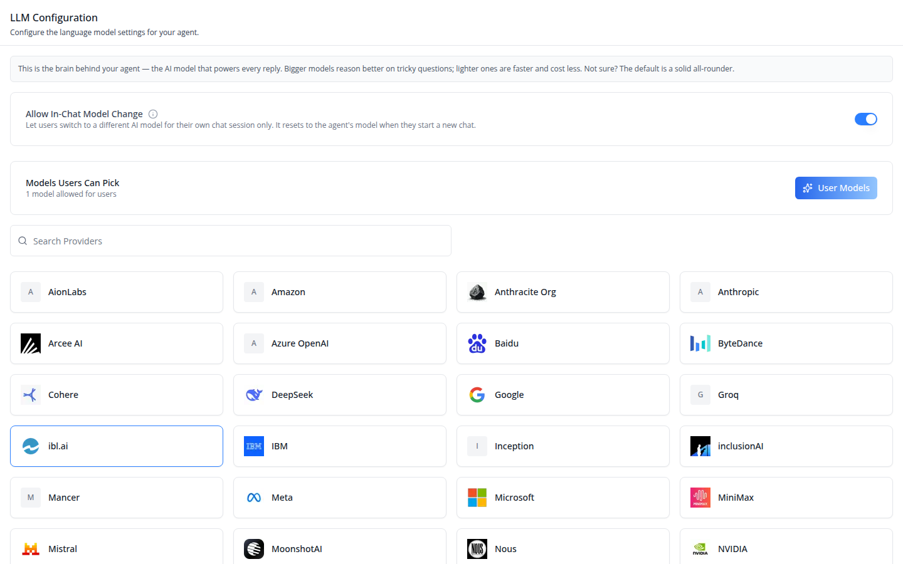
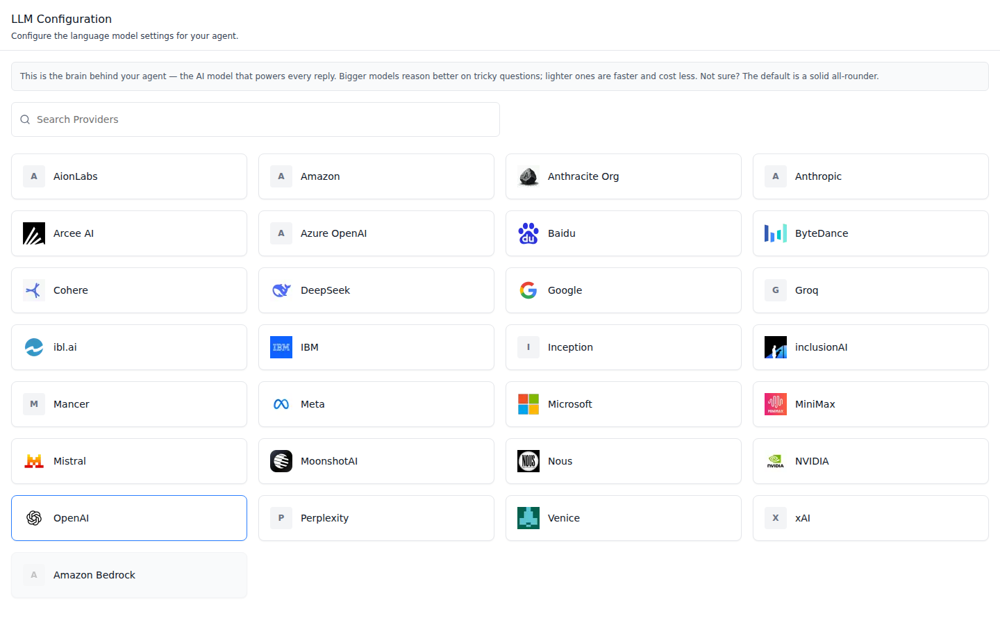
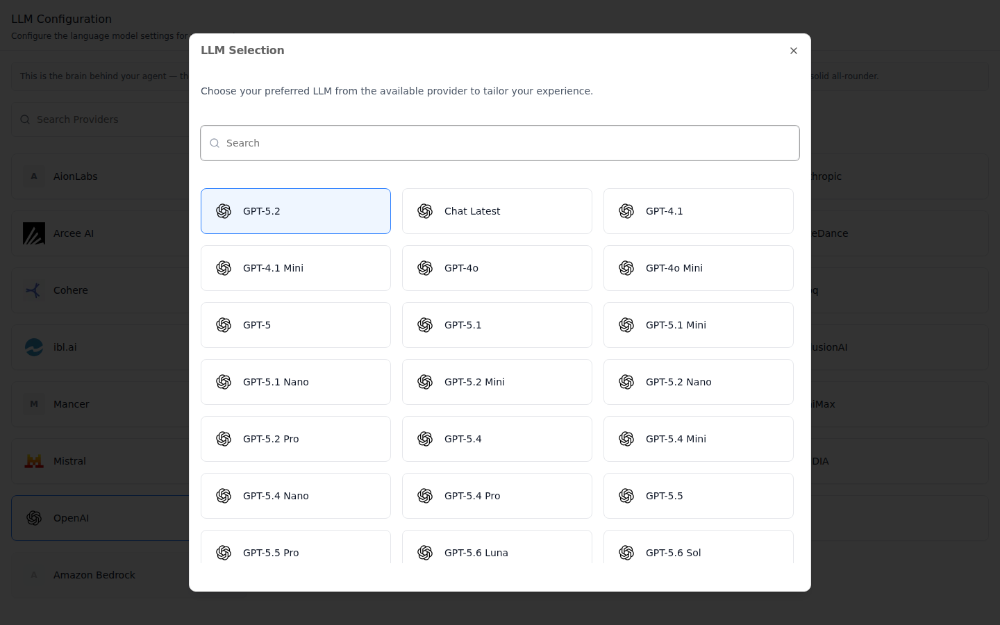
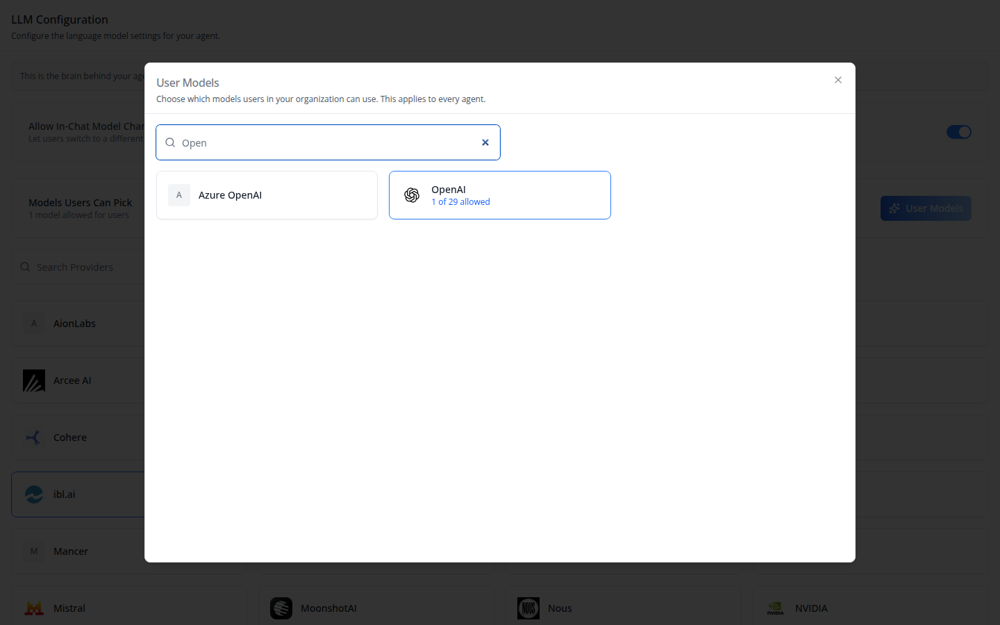
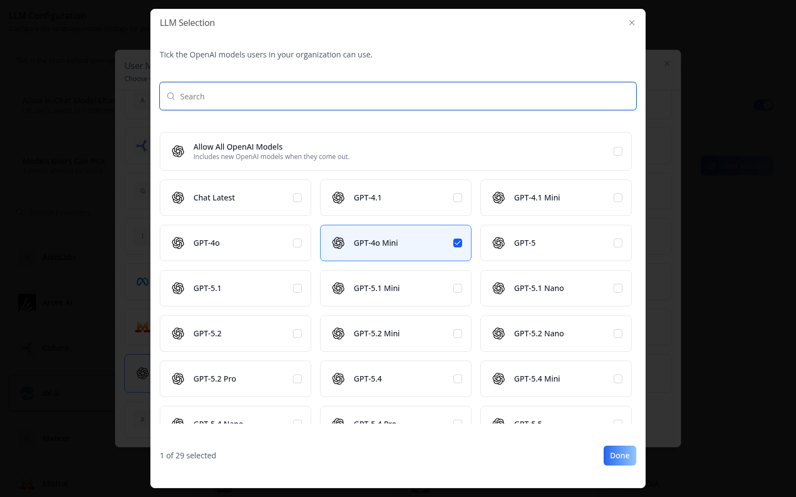

# /iblai-vibe-agent-llm

Add the agent **LLM tab** -- which provider and model the agent answers with.
**Scope: per agent.** The choice is saved on the agent's settings
(`llm_provider` + `llm_name`), so every user who chats with the agent gets the
same model. The tab shows a searchable grid of provider cards; clicking a card
opens that provider's models, and clicking a model saves it. This is one tab
in the agent-settings family indexed by `/iblai-vibe-agent`; it shares the
`AgentSettingsProvider` wrapper with every other tab.

Above the grid sit two boxes:

- **Allow In-Chat Model Change** -- a switch that lets users pick another
  model for their own chat session (it resets to the agent's model on a new
  chat). It moved here from Settings → Capabilities in `@iblai/iblai-js`
  2.44.0.
- **Models Users Can Pick** -- shown only to an organization admin
  (`isTenantAdmin`) while the switch is on. It counts the models users are
  allowed and holds the **User Models** button.



**Providers** -- one card per provider the platform offers. The agent's
current provider has a blue border. Providers the organization holds no
usable key for are tinted gray and sorted last. Names and logos come from the
API; a provider without a logo shows its initial.



**Model picker** -- a card opens **LLM Selection** with that provider's
models, searchable. The current model is highlighted. Clicking another model
saves it at once (no confirm step) and toasts "LLM updated successfully".



**User Models** opens a searchable dialog of provider cards. A card with at
least one allowed model shows "N of M allowed" or "All allowed"; the others
show no count. It sets which models users in
the organization can pick, for every agent:



A card opens the same LLM Selection modal as a checklist: **Allow All
{Provider} Models** (new models of that provider included), a checkbox per
model, "N of M selected" and **Done**. Every tick saves at once:



> **Common setup (brand, conventions, env files, verification):** see [docs/skill-setup.md](https://raw.githubusercontent.com/iblai/vibe/refs/heads/main/docs/skill-setup.md).

## Prerequisites

- Auth set up (`/iblai-vibe-auth`, or vibe-starter).
- `AgentSettingsProvider` wraps the route (`/iblai-vibe-agent` §1).
- `@iblai/iblai-js@^2.62.1` (resolves `@iblai/web-containers` 1.62.1). Check with
  `pnpm why @iblai/web-containers`; if it shows 1.16.0, run
  `/iblai-vibe-ops-upgrade`, which removes the old override.
- A real agent UUID. Ask the user; never invent one.
- Provider keys are organization settings, not part of this tab. A provider
  without a key stays grayed out; adding keys is an admin task
  (`/iblai-api-integration`).

## Step 1: Check Environment

Look for `iblai.env` in the project root with `PLATFORM`, `DOMAIN`, and
`TOKEN`. If it is missing, tell the user:
"You need an `iblai.env` with your platform configuration. Download the
template and fill in your values:
`curl -o iblai.env https://raw.githubusercontent.com/iblai/vibe/refs/heads/main/iblai.env`"

## Step 2: Mount `AgentLLMTab`

```tsx
// app/(app)/agents/[mentorId]/llm/page.tsx
"use client";

import { AgentLLMTab } from "@iblai/iblai-js/web-containers/next";
import { isTenantAdmin } from "@/lib/iblai/tenant";

export default function AgentLLMPage() {
  return (
    <div className="flex h-full flex-col bg-white">
      <AgentLLMTab isTenantAdmin={isTenantAdmin()} />
    </div>
  );
}
```

The tab reads `tenantKey`, `mentorId`, and `username` from
`AgentSettingsProvider` and does its own fetching and saving. No props are
required. Provider names and logos are owned by the API, so there is no logo
map to pass: the old `getLLMProviderDetails` prop and `LLMProviderDetails`
type are gone.

`isTenantAdmin` only decides whether the **Models Users Can Pick** box and
the User Models dialog render; the backend refuses the save for anyone who
is not an organization admin. Leave it out (default `false`) on surfaces
members reach, and in a "switch model" dialog opened from the chat.

To reuse the tab outside the settings page -- for example a "switch model"
dialog opened from the chat header -- drop the header and wrap it in its own
`AgentSettingsProvider`. The tab always reads the org, username, and RBAC
switch from the provider and throws without one (vibe-starter's chat page has
none); the `mentorId` prop only overrides the agent.

```tsx
import {
  AgentLLMTab,
  AgentSettingsProvider,
} from "@iblai/iblai-js/web-containers/next";

export function SwitchModel({
  agentId,
  tenantKey,
  username,
}: {
  agentId: string;
  tenantKey: string;
  username: string;
}) {
  return (
    <AgentSettingsProvider
      tenantKey={tenantKey}
      mentorId={agentId}
      username={username}
      enableRBAC={false}
    >
      <AgentLLMTab showConfigurationHeader={false} />
    </AgentSettingsProvider>
  );
}
```

## Step 3: Customize Labels (Optional)

The tab renders with the default agent-facing copy (`AGENT_LLM_TAB_LABELS`,
localized through the SDK's i18n). Pass a partial `labels` object to change
any string:

```tsx
import { AgentLLMTab } from "@iblai/iblai-js/web-containers/next";

<AgentLLMTab
  labels={{
    header: { title: "Model" },
    inChatModelChange: { label: "Let Users Switch Models" },
    providerModal: { title: "Choose a model" },
  }}
/>;
```

Label groups (`LLMTabLabels`): `header` (`title`, `description`), `infoBox`,
`inChatModelChange` (`label`, `description`, `tooltip`, `tooltipAriaLabel`),
`search.placeholder`, `providerLogoAlt(name)`, `toasts` (`updateSuccess`,
`updateError`), and `providerModal` -- `title`, `description(name)`,
`searchPlaceholder`, `helpText`, `providerIconAlt(name)`, the on-device
download dialogs (`tooLargeTitle`, `tooLargeDescription`, `cancel`,
`downloadAnyway`, `alreadyDownloadingTitle`, `alreadyDownloadingDescription`,
`unnamedModel`, `gotIt`), screen-reader announcements (`announce*`), and
`localModel` (`LocalModelRowLabels`, the on-device row copy).
The User Models dialog's copy is not in `labels`; it follows the SDK's locale.

## Step 4: Use MCP Tools for Customization

```
get_component_info("AgentLLMTab")
get_component_info("AgentSettingsProvider")
```

## `<AgentLLMTab>` Props

Import from `@iblai/iblai-js/web-containers/next`.

| Prop | Type | Required | Description |
|------|------|----------|-------------|
| `labels` | `DeepPartial<LLMTabLabels>` | No | Override user-visible strings |
| `showConfigurationHeader` | `boolean` | No | Show the title bar and side padding. Defaults to `true`; pass `false` inside a dialog |
| `mentorId` | `string` | No | Agent UUID to configure, overriding `AgentSettingsProvider` |
| `isTenantAdmin` | `boolean` | No | Organization admin acting as one: while Allow In-Chat Model Change is on, shows **Models Users Can Pick** and the User Models dialog (default `false`) |

## How it saves

| Control | Request | Body |
|---------|---------|------|
| Model in LLM Selection | `PUT /api/ai-mentor/orgs/{org}/users/{username}/mentors/{mentor}/settings/` (`useEditMentorMutation`) | `llm_provider`, `llm_name` |
| Allow In-Chat Model Change | same settings `PUT`, at once (through `executeGatedAction` when the provider sets one) | `enable_in_chat_llm_change` |
| User Models dialog (read) | `GET /api/core/rbac/llm-access/status/?platform_key={org}` (`useGetLlmAccessQuery`) | -- |
| Each tick in the checklist | `POST /api/core/rbac/llm-access/set/` (`useSetLlmAccessMutation`) | `{ platform_key, llm_resources }`, the whole list |

`llm_resources` holds RBAC paths: `llms/` (every model), `llms/<provider>/`
(every model of one provider, new ones included) and
`llms/<provider>/models/<llm_name>` (one model), built from the provider
`name` and the model `llm_name`. Saves run one at a time and the last tick
wins. A failed save puts the tick back; a 400 names the model that is no
longer offered and offers **Remove It**; unticking the last model asks
first (**Save with No Models?**). Users who are not admins see only the
allowed models in the chat's model picker. The endpoints are in [`/iblai-api-rbac`](https://raw.githubusercontent.com/iblai/vibe/refs/heads/main/skills/users/iblai-api-rbac/SKILL.md).

The switch follows the agent's `permissions` entry for
`enable_in_chat_llm_change`; with no entry, `enableRBAC` decides (`false`
allows it, `true` hides it).

## Test ids

| Element | `data-testid` |
|---------|---------------|
| Info box | `llm-info-box` |
| Allow In-Chat Model Change switch | `llm-in-chat-model-change-toggle` |
| Models Users Can Pick box, its count, its button | `users-models-summary`, `users-models-summary-count`, `llm-users-models-button` |
| Provider card (grid) | `llm-provider-card` (`data-provider`, `data-disabled`) |
| User Models dialog, provider card, card count | `users-models-dialog`, `users-models-provider-card` (`data-provider`), `users-models-count-<provider>` |
| Checklist rows, Done | `users-models-allow-all-<provider>`, `users-models-model-<provider>-<llm_name>`, `users-models-done` |
| Save refused, Remove It, confirm empty | `users-models-save-error`, `users-models-remove-rejected`, `users-models-confirm-empty-save` |

## Related Exports

From `@iblai/iblai-js/web-containers/next`:

- `AGENT_LLM_TAB_LABELS`, `resolveLLMTabLabels` -- the default label bundle
  and its merge helper.
- `LLMProviderModal` (`LLMProviderModalProps`) -- the model picker on its own.
  Pass `selection` (type `LLMModelSelection`: `isSelected`, `toggle`,
  `allSelected`, `toggleAll`, `labels`, `testIdPrefix`) instead of
  `onSelect` / `isSelecting` / `mentorSettings` / `llms` to get the
  checklist the User Models dialog uses.
- `LocalModelRow` (`LocalModelRowProps`, `LocalRowStatus`) -- an on-device
  model row.
- `getProviderName` -- folds provider keys and display names onto one id
  (`"Microsoft"` and `"azure_openai"` both give `azure_openai`).
- `AgentLLMTabProps`, `LLMTabLabels`, `LocalModelRowLabels`, `LLMProvider`,
  `LLMProviderType` -- types.

From `@iblai/iblai-js/data-layer`:

- `useGetLlmAccessQuery({ platform_key })`,
  `useSetLlmAccessMutation()` -- read and replace the models users can pick.

From `@iblai/iblai-js/web-containers`, for custom UI that shows a
provider's name or logo (an agents table, a transcript row):

- `useLlmProviderCatalogue({ org, userId, mentorId })` -- returns a
  resolver `(llmProvider?, llmName?) => LlmProviderDetails` over the same
  `mentor-llms` rows the tab reads (the tab reads them directly; the SDK
  uses this hook for `LlmModelBadge`); a key the catalogue does not list
  resolves to the raw key and no logo.
- `LlmProviderDetails` -- `{ logo: string | null; displayName: string }`.
- `inferProviderKeysFromModel` -- the provider keys a model name implies.

## How it saves

| Action | Request |
|---|---|
| Load | `GET mentor-llms/?mentor_id=<uuid>` (providers with `chat_models`, `logo`, and credential flags) and the agent's settings (current `llm_provider`, `llm_name`) |
| Click a model | `PUT mentors/{uuid}/settings/` with `llm_provider` and `llm_name` |

A model is disabled when its provider has no usable key or no models, or
when it is already selected.

## Platform data

| Hook | Purpose |
|---|---|
| `useGetLlmsQuery` | Providers and their models |
| `useGetMentorSettingsQuery` | The agent's current provider and model |
| `useEditMentorMutation` | Save the new provider and model |

REST twin: [`/iblai-api-agent-llm`](https://raw.githubusercontent.com/iblai/vibe/refs/heads/main/skills/agents/iblai-api-agent-llm/SKILL.md).

## Step 5: Verify

Run `/iblai-vibe-ops-test` before telling the user the work is ready:

1. `pnpm build` -- must pass with zero errors.
2. `pnpm test` -- vitest must pass.
3. Touch test `/agents/<uuid>/llm` in the browser as `/iblai-vibe-ops-test` says: the
   provider grid renders with the current provider outlined; open it -- the current
   model is highlighted; read the console; check the phone width. As an organization
   admin, turn on Allow In-Chat Model Change and check that **Models Users Can
   Pick** appears and User Models opens.

## Important Notes

- **Per agent, not per user**: everyone who chats with the agent gets the
  model chosen here.
- **No confirm step**: clicking a model saves it. Explore on a test agent.
- **RBAC**: with `enableRBAC` on, a user without write permission on
  `llm_provider` sees the provider cards but clicks do nothing.
- **On-device models**: in the ibl.ai desktop app (Tauri) the picker also
  lists downloadable on-device models (`/iblai-vibe-local-llm`); on the web it
  shows cloud models only.
- **Shared provider**: mount `AgentSettingsProvider` once at the layout
  level (`/iblai-vibe-agent` §1); do not wrap each tab.
- **Peer deps**: `sonner` and `@iblai/iblai-web-mentor`
  (`pnpm add sonner @iblai/iblai-web-mentor`).
- **The switch moved**: Allow In-Chat Model Change used to be in
  Settings → Capabilities. Since `@iblai/iblai-js` 2.44.0 it is only here,
  and the Settings tab no longer sends `enable_in_chat_llm_change`.
- **User Models is organization-wide**: the list applies to every agent in
  the organization, not just the one being edited.
- **Brand guidelines**: [BRAND.md](https://raw.githubusercontent.com/iblai/vibe/refs/heads/main/BRAND.md)
