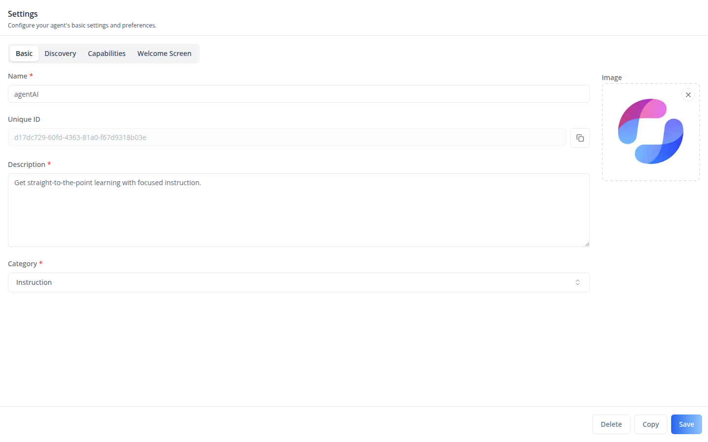
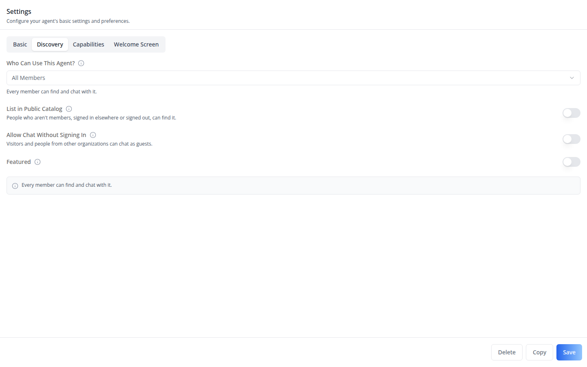
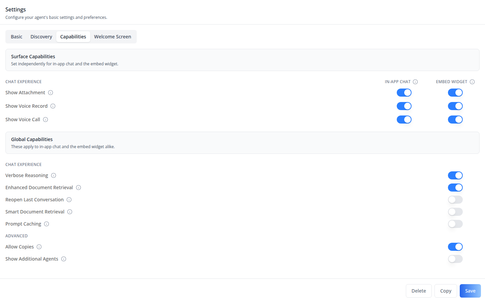
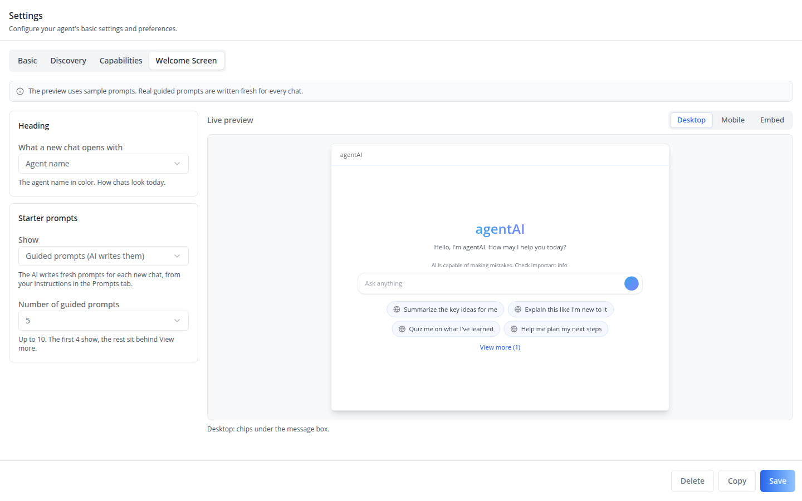
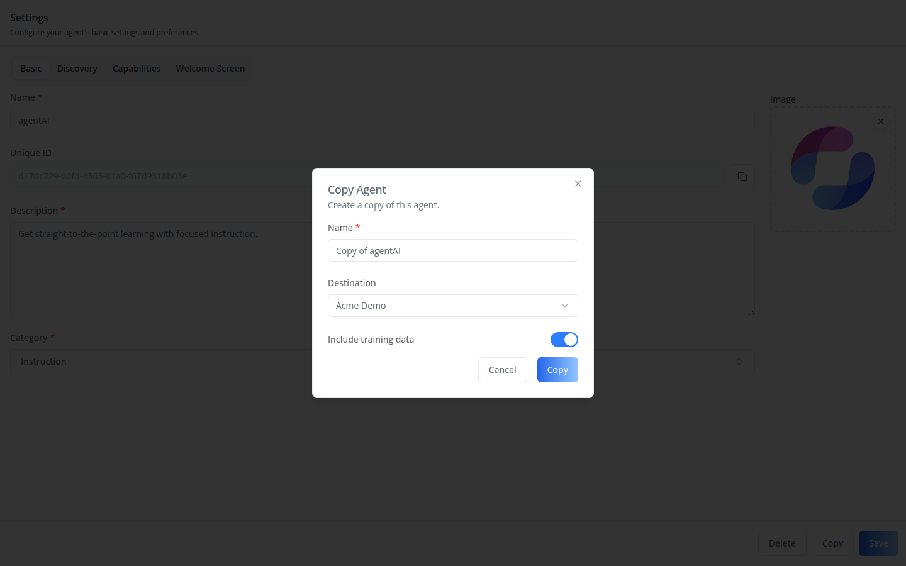

# /iblai-vibe-agent-setting

Add the agent **Settings tab** -- the core agent-edit form, split into four
sub-tabs (**Basic**, **Discovery**, **Capabilities**, **Welcome Screen**) above
a sticky Delete / Copy / Save footer (Delete and Copy only when allowed, see
**Copy** below). This is one
tab in the wider agent-settings family (`access`, `api`, `datasets`,
`disclaimers`, `embed`, `history`, `llm`, `memory`, `prompts`, `safety`,
`settings`, `tasks`, `tools`). Each tab is a separate skill. All tabs share the
same `AgentSettingsProvider` wrapper -- set it up once and mount as many
tabs as you need.

**Basic** -- name, unique ID (read-only, copyable), description, category, image.



**Discovery** -- **Who Can Use This Agent?** (All Members / Admins Only, with
help text under it), **List in Public Catalog** (off and disabled under Admins
Only), **Allow Chat Without Signing In**, the **Featured** toggle,
and a summary line saying what the combination means. The copy says
"members", never the organization's name.



The controls are two views of the same two fields; Save sends them unchanged
(`/iblai-api-agent-setting`):

| Who Can Use | Public Catalog | Chat Without Signing In | `mentor_visibility` | `allow_anonymous` |
|---|---|---|---|---|
| Admins Only | off (disabled) | off / on | `viewable_by_tenant_admins` | `false` / `true` |
| All Members | off | off / on | `viewable_by_tenant_students` | `false` / `true` |
| All Members | on | off / on | `viewable_by_anyone` | `false` / `true` |

An empty or unknown saved visibility shows as All Members with the catalog
off and is sent back unchanged unless the user changes it. Switching from
Admins Only back to All Members turns the catalog off.

**Capabilities** -- **Surface Capabilities** sets Show Attachment, Show Voice
Record and Show Voice Call separately for the in-app chat (`show_*`) and the
embed widget (`embed_show_*`). **Global Capabilities** apply to both: Verbose
Reasoning, Enhanced Document Retrieval, Reopen Last Conversation, Smart
Document Retrieval, Prompt Caching (Anthropic models; it also turns off
document retrieval, memory and the current date/time in the system prompt),
and under **Advanced** Allow Copies and Show Additional Agents. **Context
Limits** sets Chat History Messages (`chat_history_max_messages`), Chat
History Tokens (`chat_history_max_tokens`) and Document Chunks
(`rag_retrieval_k`). **Allow In-Chat Model Change** is no longer here: since
`@iblai/iblai-js` 2.44.0 it is on the LLM tab (`/iblai-vibe-agent-llm`), and
this tab's Save no longer sends `enable_in_chat_llm_change`.



**Welcome Screen** -- the heading a new chat opens with (the agent’s name or a
personalized greeting), the starter prompts (guided, suggested, or off), and a
live preview.



**Copy** -- the footer shows Copy only when the agent’s **Allow Copies** is on
(`forkable`), and Delete only when the agent’s `permissions` grant delete on
`object` (see `enableRBAC` below). Copy opens `CopyMentorModal`: name the copy,
choose whether to include training data (disabled unless the agent has
`forkable_with_training_data`), and -- when `tenants` holds two or more
organizations with `is_admin: true` -- pick the destination organization.



> **Common setup (brand, conventions, env files, verification):** see [docs/skill-setup.md](https://raw.githubusercontent.com/iblai/vibe/refs/heads/main/docs/skill-setup.md).

## Prerequisites

- Auth must be set up first (`/iblai-vibe-auth`)
- MCP server + skills configured (`@iblai/mcp` in `.mcp.json`)
- Ask the user for a real `mentorId` (agent UUID). Do NOT invent one.

## Step 1: Check Environment

Before proceeding, check for an `iblai.env` in the project root. Look for
`PLATFORM`, `DOMAIN`, and `TOKEN` variables. If the file does not exist or
is missing these variables, tell the user:
"You need an `iblai.env` with your platform configuration. Download the
template and fill in your values:
`curl -o iblai.env https://raw.githubusercontent.com/iblai/vibe/refs/heads/main/iblai.env`"

## Step 2: Wrap the Route in `AgentSettingsProvider`

All agent tabs (`AgentSettingsTab`, `AgentLLMTab`, `AgentPromptsTab`, etc.) read shared
identity from `AgentSettingsProvider`. Wrap your agent-settings route once;
every tab inside it reads from context.

```tsx
// app/(app)/agents/[mentorId]/layout.tsx
"use client";

import { AgentSettingsProvider } from "@iblai/iblai-js/web-containers/next";
import { useParams } from "next/navigation";
import { useEffect, useState } from "react";

export default function AgentSettingsLayout({
  children,
}: {
  children: React.ReactNode;
}) {
  const { mentorId } = useParams<{ mentorId: string }>();
  const [tenantKey, setTenantKey] = useState("");
  const [username, setUsername] = useState("");

  useEffect(() => {
    try {
      const raw = localStorage.getItem("userData");
      if (raw) {
        const parsed = JSON.parse(raw);
        setUsername(parsed.user_nicename ?? parsed.username ?? "");
      }

      const resolvedTenant =
        localStorage.getItem("app_tenant") ??
        (() => {
          try {
            return JSON.parse(localStorage.getItem("current_tenant") ?? "{}").key;
          } catch { return undefined; }
        })() ??
        localStorage.getItem("tenant") ??
        "";
      setTenantKey(resolvedTenant);
    } catch {}
  }, []);

  if (!tenantKey || !username) return null;

  return (
    <AgentSettingsProvider
      tenantKey={tenantKey}
      mentorId={mentorId}
      username={username}
      enableRBAC={false}
    >
      {children}
    </AgentSettingsProvider>
  );
}
```

`enableRBAC` sets the default for any field the agent’s `permissions` map
does not list: `false` allows read, write and delete, `true` hides the
control. It is not a confirmation prompt.

`executeGatedAction` (optional, `(fn: () => unknown) => unknown`) wraps saves,
for example behind a paywall prompt. It must return `fn()`: the LLM tab's
in-chat switch and the Prompts, Safety and Privacy tabs await what it returns
before toasting success and show the error toast when it rejects, so a gate
that calls `fn()` without returning it toasts success before the save settles
and drops a failed save silently. This tab's own Save does not await it.

## Step 3: Mount `AgentSettingsTab`

```tsx
// app/(app)/agents/[mentorId]/settings/page.tsx
"use client";

import { useEffect, useState } from "react";
import {
  AgentSettingsTab,
  type CopyMentorTenant,
} from "@iblai/iblai-js/web-containers/next";
import { useRouter } from "next/navigation";

export default function AgentSettingsPage() {
  const router = useRouter();
  const [tenants, setTenants] = useState<CopyMentorTenant[]>([]);
  const [isLoadingTenants, setIsLoadingTenants] = useState(true);

  useEffect(() => {
    try {
      const raw = localStorage.getItem("tenants");
      const parsed = raw ? JSON.parse(raw) : [];
      setTenants(
        parsed.map((t: any) => ({
          key: t.key,
          name: t.name ?? t.key,
          is_admin: !!t.is_admin,
        })),
      );
    } catch {}
    setIsLoadingTenants(false);
  }, []);

  return (
    <div className="flex h-full flex-col bg-white">
      <AgentSettingsTab
        tenants={tenants}
        isLoadingTenants={isLoadingTenants}
        onSuccessfulSave={(mentor) => {
          console.log("saved", mentor);
        }}
        onSuccessfulDelete={() => {
          router.push("/agents");
        }}
        onSuccessfulCopy={({ forkedMentorId, destinationTenantKey }) => {
          router.push(`/agents/${forkedMentorId}?tenant=${destinationTenantKey}`);
        }}
      />
    </div>
  );
}
```

## Step 4: Customize Labels (Optional)

`AgentSettingsTab` renders with the default agent-facing copy
(`AGENT_SETTINGS_TAB_LABELS`). Override any string via the `labels` prop.
Pass a full `SettingsTabLabels` bundle (for a full mentor/tutor/coach
re-skin) or a partial object (for one-off edits).

```tsx
import {
  AgentSettingsTab,
  type SettingsTabLabels,
  AGENT_SETTINGS_TAB_LABELS,
} from "@iblai/iblai-js/web-containers/next";

const MENTOR_LABELS: SettingsTabLabels = {
  ...AGENT_SETTINGS_TAB_LABELS,
  header: {
    title: "Mentor settings",
    description: "Configure your mentor's identity and visibility.",
  },
};

<AgentSettingsTab tenants={tenants} labels={MENTOR_LABELS} />;
```

For a partial override, pass only the keys you want to change:

```tsx
<AgentSettingsTab
  tenants={tenants}
  labels={{
    header: { title: "Tutor settings" },
    discoveryAccess: { audienceLabel: "Who Can Use This Tutor?" },
  }}
/>
```

Beyond `header`, `fields`, `actions`, `toasts`, `deleteModal` and `copyModal`,
the bundle names the sub-tabs (`subTabs.basic` / `discovery` /
`capabilities` / `welcomeScreen`), the Capabilities headings
(`sections.chatExperience`, `advanced`, `perSurface`, `globalSettings`), the
matrix columns (`surfaces.inAppChat`, `embedWidget`) and their notes
(`notes.*`), the `sections.contextLimits` heading, the Discovery controls
(`discoveryAccess`, defaults in `AGENT_SETTINGS_TAB_LABELS.discoveryAccess`;
optional, so a bundle without it falls back to English), and the confirm dialog
(`adminVisibilityConfirm`) that opens when Save switches Who Can Use This
Agent? to Admins Only -- a test that waits for the success toast must answer
it first. `fields.whoCanView` / `fields.whoCanChat` no longer label
Discovery; the Embed tab still reads them. The Allow In-Chat Model Change
copy is in the LLM tab's `LLMTabLabels.inChatModelChange`, not here.

## Step 5: Use MCP Tools for Customization

```
get_component_info("AgentSettingsTab")
get_component_info("AgentSettingsProvider")
get_component_info("CopyMentorModal")
get_component_info("DeleteMentorModal")
```

## `<AgentSettingsTab>` Props

Import from `@iblai/iblai-js/web-containers/next`.

| Prop | Type | Required | Description |
|------|------|----------|-------------|
| `tenants` | `CopyMentorTenant[]` (`{ key, name?, is_admin }`) | Yes | Organizations the agent can be copied into (forwarded to `CopyMentorModal`); only entries with `is_admin: true` are offered as destinations. Copy itself shows only when the agent allows copies |
| `isLoadingTenants` | `boolean` | No | Loading state for the organization list |
| `onSuccessfulSave` | `(mentor: MentorSettings) => void` | No | Fired after a successful save |
| `onSuccessfulDelete` | `(deletedMentorId: string) => void` | No | Fired after a successful delete |
| `onSuccessfulCopy` | `(params: { forkedMentorId, destinationTenantKey, isCrossTenantCopy }) => void` | No | Fired after a successful copy |
| `labels` | `DeepPartial<SettingsTabLabels>` | No | Override user-visible strings |

## `<AgentSettingsProvider>` Props

All tabs in the agent-settings family (`AgentSettingsTab`, `AgentLLMTab`, `AgentPromptsTab`,
etc.) read identity from this provider via `useAgentSettings()`.

| Prop | Type | Description |
|------|------|-------------|
| `tenantKey` | `string` | Current platform key |
| `mentorId` | `string` | The agent being edited |
| `username` | `string` | Current user |
| `enableRBAC` | `boolean` | Per-field RBAC gating: `false` allows fields the agent’s `permissions` omit, `true` hides them |
| `executeGatedAction` | `(fn: () => unknown) => unknown` | Optional paywall / free-trial interceptor around actions; omitted, actions run directly. Independent of `enableRBAC`. Must return `fn()` for the saves that await it (see Step 2) |

## Related Exports

From `@iblai/iblai-js/web-containers/next`:

- `DeleteMentorModal`, `CopyMentorModal` -- used internally by `AgentSettingsTab`.
  Export paths for standalone use (e.g., an "archive" action outside the tab).
- `resolveSettingsTabLabels` -- merges `DeepPartial<SettingsTabLabels>` with
  defaults. Useful when composing bundles.
- `AGENT_SETTINGS_TAB_LABELS` -- the default agent-facing bundle.

## Step 6: Verify

Run `/iblai-vibe-ops-test` before telling the user the work is ready, and give
every page, control and state this skill added its own checkpoint — one Playwright
test titled `<ID> · …` in `e2e/journeys/`, listed in `e2e/coverage.json`;
`pnpm e2e:coverage` must pass:

1. `pnpm build` -- must pass with zero errors
2. `pnpm test` -- vitest must pass
3. Touch test `/agents/<id>/settings` in the browser as `/iblai-vibe-ops-test` says: open it,
   use every control this skill added, read the console, check the phone width.

## Important Notes

- **Redux store**: Must include `mentorReducer` and `mentorMiddleware`
- **`initializeDataLayer()`**: 5 args (v1.2+)
- **`@reduxjs/toolkit`**: Deduplicated via webpack aliases in `next.config.ts`
- **Peer deps**: `sonner` and `@iblai/iblai-web-mentor` must be installed
  (`pnpm add sonner @iblai/iblai-web-mentor`)
- **Shared provider**: Mount `AgentSettingsProvider` at a layout level so
  multiple tabs (`settings`, `llm`, `prompts`, ...) share one wrapper.
  Do NOT wrap each tab page individually.
- **Organizations list**: The `tenants` prop drives the **Copy to organization** flow.
  The destination picker appears only when two or more entries have
  `is_admin: true` -- keep `is_admin` when mapping `localStorage.tenants`.
  If the user should not be able to copy cross-organization, pass an empty array.
- **Labels ownership**: Consumer-specific bundles (agent, tutor, coach)
  live in the consuming app, not in `@iblai/iblai-js`. The package only
  ships `AGENT_SETTINGS_TAB_LABELS` as a neutral default.
- **REST reference**: [`/iblai-api-agent-setting`](https://raw.githubusercontent.com/iblai/vibe/refs/heads/main/skills/agents/iblai-api-agent-setting/SKILL.md)
  — the agent-settings API (headless twin, same repo)
  behind this tab (name, visibility, feature flags, fork). Install:
  `npx skills add iblai/vibe --all`
- **Brand guidelines**: [BRAND.md](https://raw.githubusercontent.com/iblai/vibe/refs/heads/main/BRAND.md)
