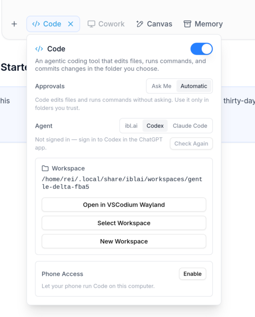
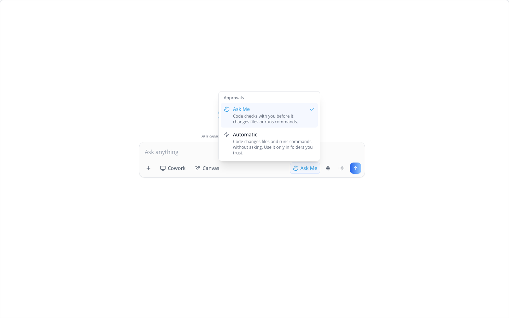
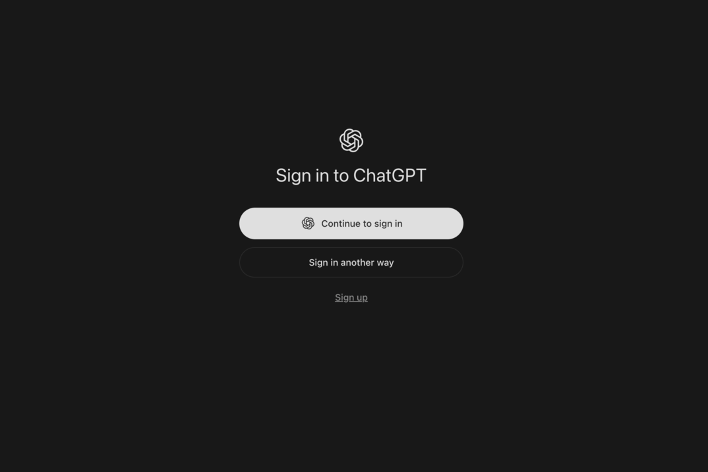
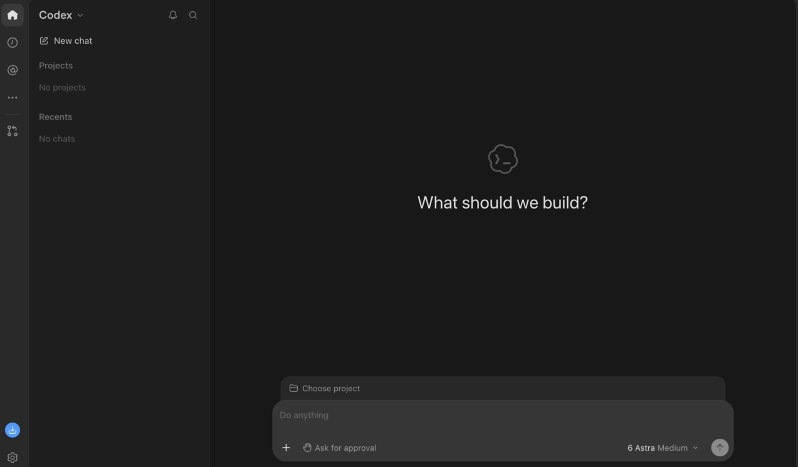
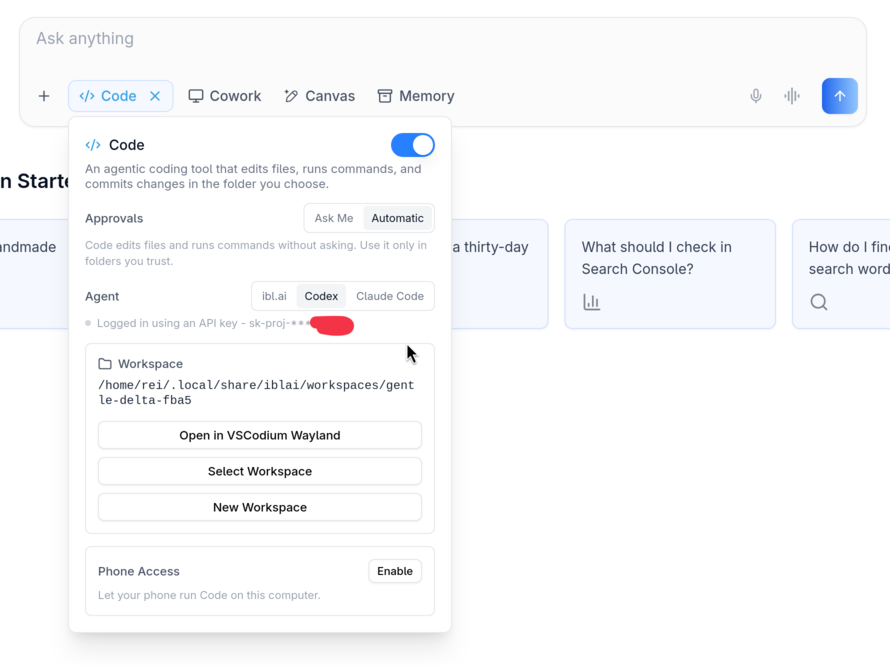
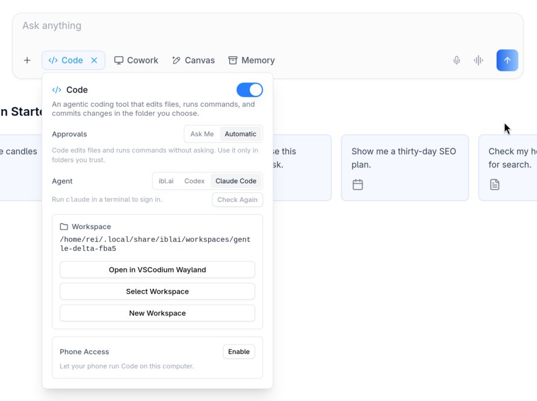
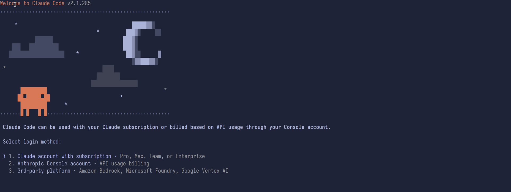
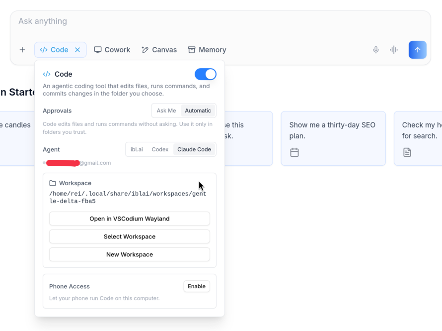
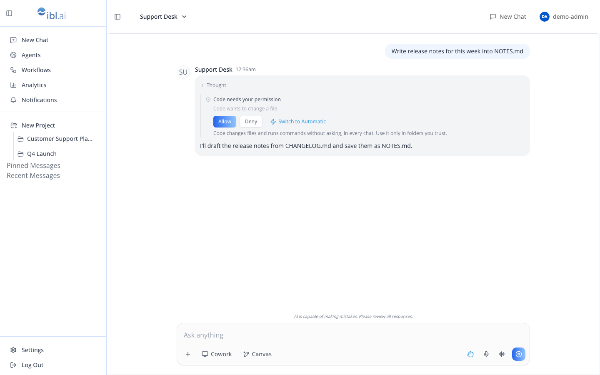

# /iblai-vibe-os-agent-code-mode

**Code** is the ibl.ai desktop app's coding helper. Turn it on under the
message box and the agent stops only answering: it edits files, runs
commands and saves its work in a folder on your computer. **Approvals**
decides whether it asks you first. It can do the work itself, or hand it
to Codex or Claude Code on your own ChatGPT or Claude plan, and with
**Cowork** on it can use your screen too. The first half of this page is
how to use it; the second half adds it to an app of your own.



> **Common setup (brand, conventions, env files, verification):** see
> [docs/skill-setup.md](https://raw.githubusercontent.com/iblai/vibe/refs/heads/main/docs/skill-setup.md).

## Using Code in the ibl.ai desktop app

### 1. Turn it on

Click **Code** under the message box: its panel opens, and the switch at
the top turns Code on. On first use Code also asks you to choose a folder
and downloads what it needs. The pill spins for a moment while it picks up
the agent's skills.

**Approvals** decides whether Code asks before it acts. It is in the panel
and, while Code is on, as a button beside **Send** (a hand for Ask Me, a
lightning bolt for Automatic):



- **Ask Me** — every file change and every command shows up as a card in
  the reply that you allow or deny.
- **Automatic** — Code works without asking. *Use it only in folders you
  trust.* With Cowork on, it also acts on your screen without asking.

A computer where nobody has chosen yet runs **Automatic**. An Ask Me you
chose on another computer is carried over to one that has no choice saved;
an Automatic is not.

### 2. Choose who does the work

The **Agent** row picks who runs Code. The line under it tells you what is
still missing before you can send.

| Agent | What you need | What it runs on |
|---|---|---|
| **ibl.ai** | Nothing to sign in to | Your organization's models and credits, or the model on this computer when Local Models is on, with the app's skills |
| **Codex** | A ChatGPT plan, or an OpenAI API key | OpenAI's Codex, on your plan |
| **Claude Code** | A Claude plan, or an Anthropic Console account | Anthropic's Claude Code, on your plan |

What the line under the row means:

- **Not installed** / **Installing…** — the app installs Codex and Claude
  Code by itself when it starts; if that failed, **Install** tries again.
- **Not signed in** — sign in, next step.
- A grey dot with your account (or **Ready**) — good to go.
- **Not available on this computer** — Windows, or the Mac App Store
  build; see *When something's off* below.

While Code runs on Codex or Claude Code, the picker at the top left shows
that agent and its model ("Codex · GPT-6-Luna", "Claude Code · Default" in
the pictures). Change the model there. The choice is saved on this
computer only.

**On this computer's model.** With Local Models on
([`/iblai-vibe-local-llm`](../iblai-vibe-local-llm/SKILL.md)), the ibl.ai
agent runs Code on the model on this computer. The app runs a copy of it
sized to 32,768 tokens, so the model sees all its tools, and refuses a
model that cannot reach that size in plain words. The first reply in a chat
can take a few minutes; the line under the reply says so.

### 3. Sign in to Codex

Choose **Codex**. The line reads *Not signed in — sign in to Codex in the
ChatGPT app.* with a **Check Again** button:


1. Open the ChatGPT app and go to **Codex**. No ChatGPT app yet? Download
   it from [chatgpt.com](https://chatgpt.com/) — Codex is part of it; there
   is no separate app to install.
2. Sign in there with the account that has your plan:

   

   You are in when Codex asks *What should we build?*:

   

3. Back in the ibl.ai app, click **Check Again**. The line now shows how
   you are signed in:

   

Prefer a terminal? Install the Codex command-line tool with OpenAI's
one-line installer, `curl -fsSL https://chatgpt.com/codex/install.sh | sh`,
then run `codex` and pick **Sign in with ChatGPT**, **Sign in with Device
Code** or **Provide your own API key** from its menu; the ibl.ai app picks
that sign-in up on **Check Again** too.

If you send a message before signing in, a small notice says **Codex isn’t
signed in** and repeats the hint.

### 4. Sign in to Claude Code

Choose **Claude Code**. Claude Code signs in from a terminal, so the line
reads *Not signed in — run `claude` in a terminal.* with a **Check Again**
button:



1. Open a terminal and run `claude`. If the command is not found, install
   Claude Code first from [claude.ai/code](https://claude.ai/code).
2. Pick **Claude account with subscription** (or the Console account if
   you pay per use) and finish in the browser it opens:

   

3. Back in the app, click **Check Again**. The line shows your account:

   

If you send a message first, the notice **Claude Code isn’t signed in**
repeats the terminal hint.

### 5. Pick the workspace

The **Workspace** is the folder Code works in. The app makes one for you
under `~/.local/share/iblai/workspaces/` with a name like
`gentle-delta-fba5`; **New Workspace** makes another, **Select Workspace**
points Code at a folder of your own, and **Open in Finder** (or *Open in
…* with whatever opens folders on your computer) shows you what is in it.
Every change Code makes is saved there as a step you can go back to.

### 6. Approve what Code wants to do

With **Ask Me** on, each thing Code wants to do appears in its reply as a
card titled **Code needs your permission**, saying what it wants (change a
file, run a command, use the screen…) with **Allow** and **Deny**.
**Switch to Automatic** allows this step and stops the cards in every chat.
A card left alone for three minutes counts as Deny. With **Automatic** on,
no cards appear on any agent.



### 7. Code with Cowork

Turn **Cowork** on as well and Code keeps the turn, with the screen tools
added: one message can edit a file and then click through an app to check
it. Approvals covers the screen too; with Ask Me, every screen action gets
a card. Turning Cowork on or off mid-chat keeps the chat. Setting up Cowork
(the consent, the two macOS permissions) is in
[`/iblai-vibe-os-agent-cowork`](../iblai-vibe-os-agent-cowork/SKILL.md).

### 8. Code from your phone (paused)

For now the iPhone and Android apps show no **Code** pill: the way a phone
connects to a computer's Code is not ready yet. A phone that paired with a
computer earlier stops sending its messages to that computer's Code. The
computer's panel still has **Phone Access**, but there is nothing on the
phone to pair with it until this comes back.

### When something's off

| The panel says | What to do |
|---|---|
| **Not available on this computer** | Code needs a Mac or Linux build from ibl.ai; Windows and the Mac App Store build cannot run it. |
| **Code needs bubblewrap (bwrap)** | Linux only. Install it with your package manager, then reopen the app. |
| **Skills couldn’t be synced — Code will run without them** | Code still works; it just does not know the ibl.ai skills this time. Check your connection and turn Code off and on. |
| **Codex isn’t signed in** / **Claude Code isn’t signed in** | Steps 3 and 4 above. |
| *… isn’t available for Code — turns will fail* | You are on an on-device model that cannot use tools. Pick another model at the top left; see [`/iblai-vibe-local-llm`](../iblai-vibe-local-llm/SKILL.md). |

## Adding Code to your own app

The copies below are the OS app's own implementation of Code, with Codex
and Claude Code: the Rust modules in
[`assets/tauri/src-tauri/`](assets/tauri/src-tauri/) (copy into your
`src-tauri/`, same layout as `/iblai-vibe-ops-build`'s templates, nothing to
render) and the composer pieces in [`assets/nextjs/`](assets/nextjs/). The
mechanics, every command and event, and the wiring are in
[`references/`](references/).

How it works, in one paragraph: with the Code pill on, a chat turn no
longer goes to the hosted agent. The Tauri backend spawns the chosen agent
(opencode for ibl.ai, or Codex or Claude Code through their Agent Client
Protocol adapters) as a per-chat subprocess and drives it over ACP. The
ibl.ai agent's model calls go to ibl.ai's OpenAI-compatible API through a
loopback proxy that injects the user's token. The agent edits files, runs
commands and commits in a git-backed workspace. With **Ask Me**, every
operation it wants surfaces as a permission card in the SDK chat; with
Cowork on too, it also gets the screen tools.

### Prerequisites

1. **Tauri shell** via [`/iblai-vibe-ops-build`](../../ship/iblai-vibe-ops-build/SKILL.md)
   — `src-tauri/` with the template `lib.rs`, plus the Rust toolchain.
2. **Sign-in** via [`/iblai-vibe-auth`](../../start/iblai-vibe-auth/SKILL.md)
   — Code reads the org key and session token from the SDK's auth storage.
3. **`@iblai/iblai-js@^2.85.1`** (resolves `@iblai/web-containers` 1.81.1):
   the SDK `<Chat>` renders the permission cards, the thinking and the tool
   activity itself, and takes the Code pill and the Approvals button
   through its `slots`.
4. **Platform**: a macOS or Linux desktop (Linux also needs
   `bwrap`/bubblewrap on PATH for the sandbox; Codex and Claude Code need
   macOS 13.5 or later). **Windows is not supported** (`install_opencode`
   returns an error and the pill hides). A **Mac App Store** build hides it
   too: under the App Sandbox the app can't spawn the downloaded binaries,
   so ship the Developer ID / notarized `.dmg` from `/iblai-vibe-ops-build`.
   Phones show no Code pill for now (`use-code-shown-here.ts`).
5. Ask the user for a real agent UUID for testing. Do NOT invent one.

### Step 1: Rust — drop in the modules

```bash
mkdir -p src-tauri/permissions
cp -R <skill>/assets/tauri/src-tauri/src/*            src-tauri/src/
cp    <skill>/assets/tauri/src-tauri/permissions/code-mode.toml   src-tauri/permissions/
cp    <skill>/assets/tauri/src-tauri/capabilities/mobile-pairing.json src-tauri/capabilities/
```

| File | What it is |
|---|---|
| `opencode_acp.rs` | The ACP transport: one agent child per chat (opencode, Codex or Claude Code), sandboxing (macOS `sandbox-exec`, Linux `bwrap`), the approval mode, permission requests, workspaces, per-agent skills, session reuse and reaping, the sized on-device model, and the screen tools when Cowork is on |
| `opencode_proxy.rs` | Loopback token-injecting proxy the agent's model calls go through; mints the scoped `IBLAI_API_KEY`; composes `AGENTS.md` guidance |
| `opencode_installer.rs` | Downloads the pinned opencode release (1.19.0), writes `opencode.json`, syncs the latest `iblai/vibe` release into the agent's skills |
| `code_agent_installer.rs` | Installs and updates Codex and Claude Code (a pinned Node runtime plus their ACP adapters from npm), checks their sign-in |
| `code_agent_models.rs` | The Codex and Claude Code model lists behind the top-left picker |
| `opencode_build_prompt.txt` | System-prompt line compiled in via `include_str!` — keep the name |
| `remote_code.rs`, `remote_code_client.rs` | The phone-access host and the phone client (paused in the OS for now; they still compile) |
| `permissions/code-mode.toml` | One `allow-*` per command, grouped as the `code-mode` set |
| `capabilities/mobile-pairing.json` | Camera permissions for scanning the pairing QR (iOS/Android only) |

Then wire them — module declarations with their `cfg` gates, the
`emit_on_main` helper, `log_fe`, plugins, setup hooks, the two
`generate_handler!` lists, and the exit and resume hooks — exactly as in
[`references/lib-rs-wiring.md`](references/lib-rs-wiring.md). Add the
Cargo entries from [`references/cargo-deps.toml`](references/cargo-deps.toml)
and reference the `code-mode` set from `capabilities/default.json` per
[`references/capabilities.md`](references/capabilities.md).

**Keep the shell's own commands allowed.** Once `src-tauri/permissions/`
holds a file, Tauri refuses every app command no capability allows,
including the shell's `open_external_url`, `allow_in_app_purchase` and
`get_locked_tenant`. The build still passes and the SDK falls back
quietly, so nothing says why. A shell from `/iblai-vibe-ops-build` allows
them in `permissions/shell.toml`. If yours has no such file, copy
[`shell.toml`](../../ship/iblai-vibe-ops-build/assets/tauri/src-tauri/permissions/shell.toml)
in and add its three `allow-*` entries to `default.json`.

**Stubs.** `opencode_acp.rs` reaches into the Cowork driver, the on-device
model manager and telemetry. Add the five small stub files in the wiring
reference (§4) for any of those you have not added; cloud Code never calls
them. [`/iblai-vibe-os-agent-cowork`](../iblai-vibe-os-agent-cowork/SKILL.md)
replaces the two Cowork stubs with the real modules.

```bash
cd src-tauri && cargo check          # must compile before touching the frontend
```

### Step 2: Frontend — the transport is already in the SDK

`useChat` (from `@iblai/iblai-js/web-utils`, used by the SDK `<Chat>`) routes a turn
to `opencode_chat_stream` whenever **both** hold:

- `isTauriCodeHost()` — a Tauri desktop (a phone only when paired, which the
  OS has paused);
- `localStorage.ibl_coding_mode_enabled === "true"`.

It reads `ibl_coding_mode_model` (`provider/model`) and
`ibl_coding_mode_mentor` (the active agent UUID, for that agent's synced
skills), calls the command with the session token, and adds `cowork: true`
when Cowork is on and this computer has the screen driver. It listens on
`ollama:token` / `ollama:done` / `ollama:error` / `ollama:restart` plus
`opencode:reasoning` / `opencode:tool_call`, and the chat's message bubble
listens on `opencode:permission_request` for the cards. Stop →
`opencode_stop`; chat closed → `opencode_close`. Nothing per-surface to wire
for the transport or the cards.

### Step 3: Frontend — mount the Code pill and the Approvals button

Copy [`assets/nextjs/`](assets/nextjs/) into your app, adapt the `@/…`
imports, and pass the two controls to the SDK `<Chat>` through `slots`, as
the OS app's chat page does:

```tsx
// app/(app)/page.tsx — the <Chat> props the Code pieces add
<Chat
  {...chatProps}
  config={{ ...chatConfig, onSwitchToAutomatic: () => chooseMode("auto", { quiet: true }) }}
  slots={{
    composerExtraControls: codeShown ? (
      <CodingModeButton sessionId={sessionId} skillSync={skillSync} approvalsSlot={null} />
    ) : undefined,
    composerActionControls:
      codeShown && approvalsOffered ? (
        <CodeApprovalsButton mode={approvalMode} onChange={(mode) => void chooseMode(mode)} />
      ) : undefined,
  }}
/>
```

where `codeShown = useCodeShownHere(inTauri)`, `{ chooseMode } =
useApprovalModeChoice(inTauri)`, `approvalMode = useApprovalMode()` and
`approvalsOffered = useApprovalsOffered()` (both from
`code-approvals-button.tsx`), and `skillSync = useOpencodeSkillSync({ org,
mentorUniqueId })`. Call `useOpencodeLearner()` and `useOpencodeAuthRequired()`
once near the app root.

| Asset | Role |
|---|---|
| `components/chat-input-form/coding-mode-button.tsx` | The **Code** pill + popover: the switch, **Approvals** (Ask Me / Automatic, with the screen line when Cowork is on), **Agent** (ibl.ai / Codex / Claude Code with install and sign-in status), the workspace (Select / New / open folder), skills status, desktop **Phone Access**. Writes the `ibl_coding_mode_*` flags |
| `components/chat-input-form/code-approvals-button.tsx` | The SDK's `ApprovalsModeButton` with the app's strings, and the one shared approval-mode store (`createApprovalModeStore`) |
| `components/chat-input-form/use-approval-mode-choice.ts` | Saves a choice on the computer (`set_opencode_permission_mode`) and to the user's platform metadata under `code_mode` |
| `components/chat-input-form/code-agents.ts` | The three agents and their labels |
| `hooks/use-code-shown-here.ts` | Shows the pill on a desktop app only (never on a phone, never during hydration) |
| `hooks/use-opencode-skill-sync.ts` | Fetches the active agent's Agent Skills + resources and writes them to disk (`begin_opencode_skills_sync` + `set_opencode_skills`), with bounded retries |
| `hooks/use-opencode-learner.ts` | On sign-in calls `set_opencode_learner` (who the agent acts as, DM base, platform domain, auth URL) |
| `hooks/use-opencode-auth-required.tsx` | The *Codex isn’t signed in* / *Claude Code isn’t signed in* notice on `opencode:auth_required` |
| `lib/cowork-approvals.ts`, `lib/local-llm-flags.ts` | Small storage readers the button uses (is Cowork on, is Local Models on) |
| `messages/code-mode.en.json` | The `next-intl` strings (`chatInputFormCodingModeButton`, plus `common.close`) |

**Adapt these imports** (everything else is shadcn primitives + SDK):

| In the asset | In a vibe-starter app |
|---|---|
| `@/lib/config` → `{ config, getEnv }` | `import config, { getEnv } from '@/lib/iblai/config'` (`config` is the default export there); same `config.dmUrl()`, `config.platformBaseDomain()` |
| `@/lib/auth-storage` | `getAuthItem` from `@iblai/iblai-js/web-utils` |
| `@/types/tauri` → `isTauriApp`, `isTauriMobile`, `isTauriPhone` | [`/iblai-vibe-local-llm`'s `types/tauri.ts`](../iblai-vibe-local-llm/assets/nextjs/types/tauri.ts) has `isTauriApp` only. Add `isTauriPhone()` (`platform()` from `@tauri-apps/plugin-os` is `ios` or `android`, `false` when it throws) and `isTauriMobile()`, the same as a `Promise` |
| `@/hooks/use-mentors/use-mentor-settings` → `useMentorSettings().data` with `llmProvider`, `llmName` | a hook over `useGetMentorSettingsQuery({ mentor, org })` from `@iblai/iblai-js/data-layer` returning `{ data: { llmProvider: llm_provider, llmName: llm_name } }` (only pre-selects the agent's model) |
| `@/hooks/use-tauri-offline` → `isTauriOfflineMode()` | `() => localStorage.getItem('ibl_local_llm_enabled') === 'true'` if you have local models, else `() => false` |
| `@/lib/utils` → `getUserOS()` | a `getUserOS()` returning `"macOS"`, `"Windows"`, … (the pill compares those): map `platform()` from `@tauri-apps/plugin-os`, or read `navigator.userAgent` as the OS does |
| `@/hooks/use-user`, `@/features/utils` → `useUsername`, `getUserEmail` | both from `@iblai/iblai-js/web-utils` |
| `@/components/ui/{popover,switch,tooltip,button}` | `switch` and `button`: the starter's. `popover` and `tooltip` must be shadcn's **Radix** ones: the pill uses `asChild`, `PopoverAnchor` and `collisionPadding`, which the starter's base-nova (Base UI) primitives lack. `npx shadcn@latest add https://ui.shadcn.com/r/styles/new-york-v4/popover.json https://ui.shadcn.com/r/styles/new-york-v4/tooltip.json`, then point the `cn` import it writes at `@/lib/utils` and `pnpm remove cn` (it installs an unrelated package by that name). Wrap the app in its `TooltipProvider` once (in `app/layout.tsx`), or the pill throws on mount |
| `next-intl` `useTranslations('…')` | already installed: merge `messages/code-mode.en.json` into every `messages/<locale>.json`, or inline the strings |

Frontend deps:

```bash
pnpm add @tauri-apps/api @tauri-apps/plugin-dialog @tauri-apps/plugin-opener
pnpm add @tauri-apps/plugin-barcode-scanner   # the pill imports it; it runs on phones only
```

An app that ships Code but not Cowork should pass `features: { cowork:
false }` in the chat's `config`; otherwise the desktop shows a disabled
Cowork pill (see `/iblai-vibe-os-agent-cowork`).

### Step 4: Use MCP tools for the SDK side

```
get_hook_info("useChat")
get_component_info("Chat")
get_component_info("ApprovalsModeButton")
get_api_query_info("useGetAgentSkillsQuery")
```

## Linked SDK exports

From `@iblai/iblai-js/web-containers/next`:

- `ApprovalsModeButton` (+ `ApprovalsModeButtonProps`,
  `ApprovalsModeButtonLabels`) — the composer's Approvals button and menu.
- `createApprovalModeStore` (+ `ApprovalModeStore`) — one mode shared by
  every Code control on screen: `useApprovalMode`, `setApprovalMode`,
  `applyApprovalMode`, `loadApprovalMode`, `seedApprovalMode`,
  `useOfferApprovals`, `useApprovalsOffered`.
- `PERMISSION_MODES`, `PERMISSION_MODE_ICONS`, `PermissionMode` (`manual` |
  `auto`).
- `Chat` with `slots.composerExtraControls`, `slots.composerActionControls`
  and `config.onSwitchToAutomatic` (`/iblai-vibe-agent-chat`).

From `@iblai/iblai-js/web-utils` (the transport lives here):

- `useChat` — routes turns to Code when the flags are set; fills
  `reasoningContent` / `toolCalls` on the streaming message.
- `isTauriDesktop()`, `isTauriEmbeddedLLMHost()` — the public platform
  predicates (`isTauriCodeHost` is internal to web-utils).

From `@iblai/iblai-js/data-layer`:

- `useLazyGetAgentSkillsQuery`, `useLazyGetMentorSkillAssignmentsQuery`,
  `useLazyGetAgentSkillResourcesQuery` — the skills sync source
  ([`/iblai-vibe-agent-skills`](../iblai-vibe-agent-skills/SKILL.md)).
- `useGetUserPlatformMetadataQuery`, `useUpdateUserPlatformMetadataMutation`
  — the `code_mode.permission_mode` preference that follows the user
  ([`/iblai-vibe-user-metadata`](../../users/iblai-vibe-user-metadata/SKILL.md)).
- `useGetMentorSettingsQuery` — the agent's LLM provider/model, pre-selected
  as the Code model.

## Security (read before shipping)

- **Ask Me's cards are the boundary.** The agent runs at the user's own
  privilege; the sandbox only hides secrets and confines writes. With Ask
  Me, nothing changes until the user answers a card, and a card left alone
  for three minutes is denied. Codex is pinned read-only under Ask Me.
- **Automatic is the default.** A computer with no saved choice runs
  Automatic (`get_opencode_permission_mode` returns `"auto"`), and an
  unreadable settings file reads as Ask Me. Show the Approvals button so
  people can see and change it; a profile's Ask Me is copied to a computer
  with nothing saved, an Automatic never is.
- **With Cowork on, Automatic includes the screen.** Say so where people
  choose it (the shipped hint does).
- **The session token never reaches the agent** — the loopback proxy
  injects it. The one credential handed over is a scoped, week-long,
  revocable platform API key (`IBLAI_API_KEY`), so the synced `iblai-*`
  skills can act on the platform; non-admins get none and turns continue.
- **Phone access** binds `0.0.0.0` with a fresh password per enable and is
  killed with the app. Show the QR only to the person at the desk.

Full rationale, on-disk layout, and the agent's environment:
[`references/architecture.md`](references/architecture.md).

## Verify

1. `cd src-tauri && cargo check` — zero errors.
2. `pnpm build` — zero errors; `pnpm test` passes.
3. `pnpm exec tauri dev` (desktop): open a chat, click **Code** — the first
   click installs opencode (log lines on `model:installation-log`). Choose
   **Ask Me** with the Approvals button, ask the agent to *"create
   hello.txt with one line"*; a **Code needs your permission** card
   appears in the reply; Allow; the file exists under
   `~/.local/share/iblai/workspaces/…`. Switch to Automatic and repeat: no
   card.
4. Touch test `/` in the browser as `/iblai-vibe-ops-test` says: in a plain
   browser there is **no** Code pill (it is desktop-only).

## Platform data

| Call | Purpose |
|---|---|
| `POST {asgi}/api/ai-mentor/orgs/{org}/v1/chat/completions` | the ibl.ai agent's model calls, via the loopback proxy with the session token injected |
| `GET {dm}/api/ai-mentor/orgs/{org}/v1/models` | the Code model picker |
| `GET …/orgs/{org}/agent-skills/`, `…/agents/{uuid}/skills/`, `…/agent-skill-resources/` | the agent's skills synced to disk — [`/iblai-api-agent-skill`](../iblai-api-agent-skill/SKILL.md) |
| `POST {dm}/api/core/platform/api-tokens/` (by `platform_api_key`) | the scoped `IBLAI_API_KEY` — [`/iblai-api-token`](../../organizations/iblai-api-token/SKILL.md) |
| `GET/POST {dm}/api/core/users/platform-metadata/` (`code_mode.permission_mode`) | approval mode following the user — [`/iblai-api-profile-metadata`](../../users/iblai-api-profile-metadata/SKILL.md) |
| `https://github.com/iblai/vibe/releases/latest` | the vibe skills the agent gets, resolved at every launch |
| `https://github.com/sst/opencode/releases`, `https://nodejs.org/dist/`, the npm registry | opencode, and the Node runtime and ACP adapters for Codex and Claude Code |

## Related skills

- [`/iblai-vibe-ops-build`](../../ship/iblai-vibe-ops-build/SKILL.md) — the Tauri shell this drops into.
- [`/iblai-vibe-local-llm`](../iblai-vibe-local-llm/SKILL.md) — on-device models Code can run against; also the `types/tauri.ts` probes.
- [`/iblai-vibe-agent-chat`](../iblai-vibe-agent-chat/SKILL.md) — the SDK chat surface whose transport carries Code turns.
- [`/iblai-vibe-agent-skills`](../iblai-vibe-agent-skills/SKILL.md) — the Agent Skills the sync hook materialises for the agent.
- [`/iblai-vibe-agent-sandbox`](../iblai-vibe-agent-sandbox/SKILL.md) — the *platform-side* sandbox kinds (Computing Runtime / VM Shell / Claw); Code mode is the *desktop-side* runtime and is independent of them.
