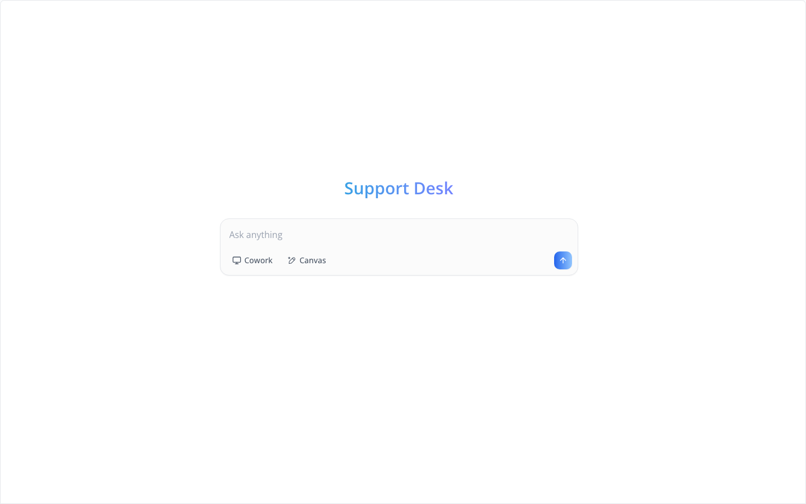
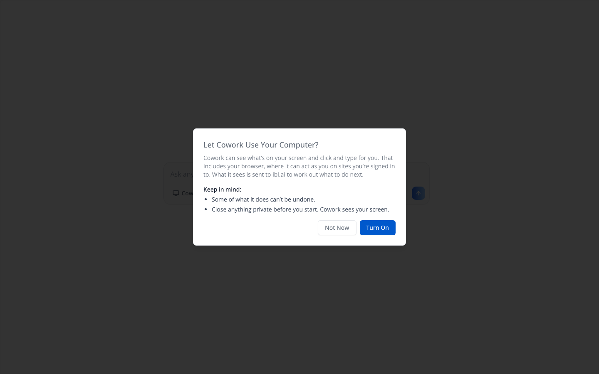
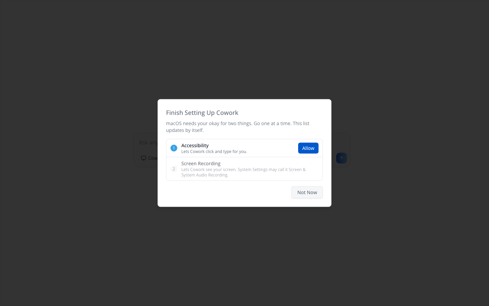
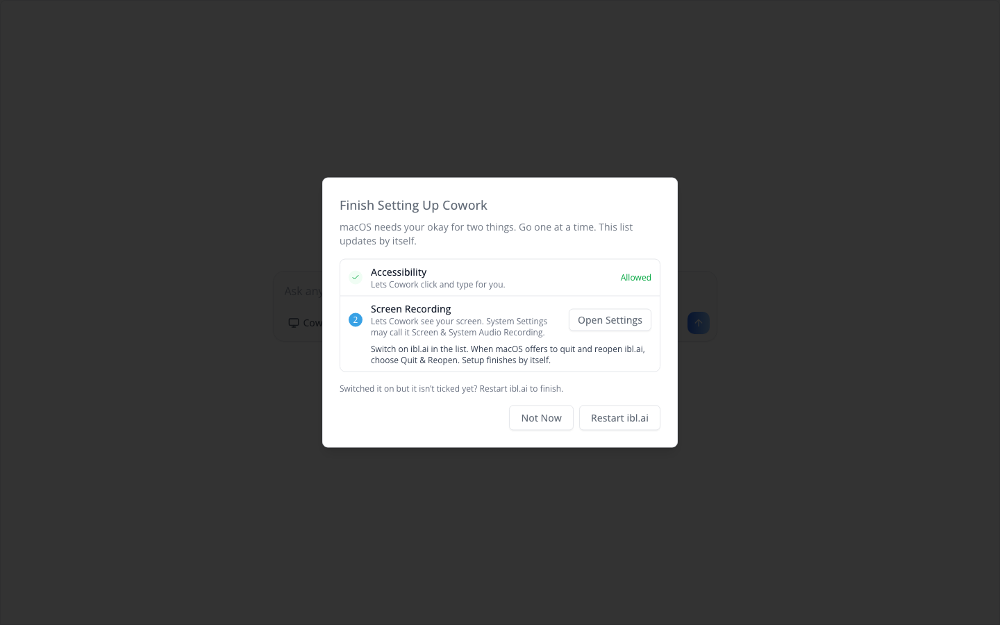
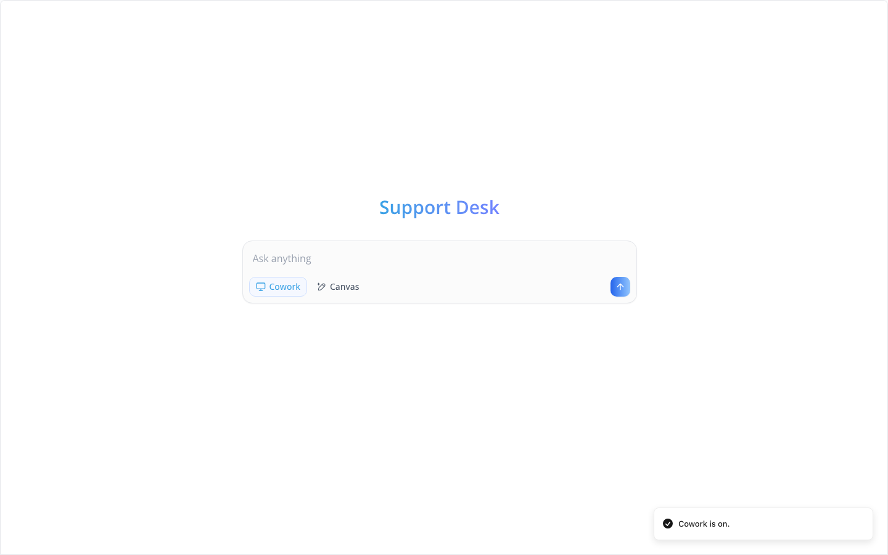
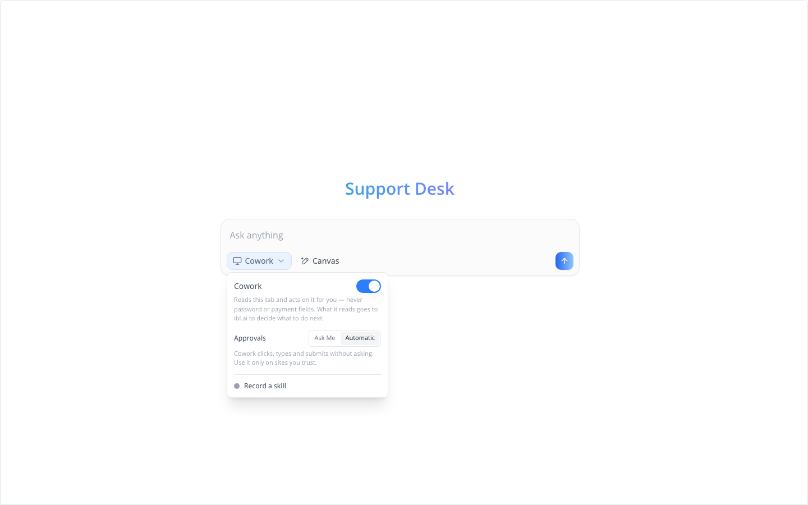

# /iblai-vibe-os-agent-cowork

**Cowork** lets the agent use your computer. Turn it on under the message
box and the agent can see what is on the screen, open apps, and click and
type for you, including in your browser on sites you are signed in to. It
asks once before it starts, walks a Mac through the two permissions macOS
needs, and works next to **Code** in the same turn. The first half of this
page is how to use it; the second half adds it to an app of your own.



> **Common setup (brand, conventions, env files, verification):** see
> [docs/skill-setup.md](https://raw.githubusercontent.com/iblai/vibe/refs/heads/main/docs/skill-setup.md).

## Using Cowork in the ibl.ai desktop app

### 1. Turn it on

Click **Cowork** under the message box. The first time, it asks **Let
Cowork Use Your Computer?** and says what that means: it sees your screen,
clicks and types for you, can act as you on sites you are signed in to, and
sends what it sees to ibl.ai to work out the next step. Nothing is asked of
macOS yet.



- **Turn On** remembers your answer and downloads the screen driver Cowork
  uses (once). Later, the pill turns on without asking again.
- **Not Now** (or Escape) leaves Cowork off and remembers nothing.

### 2. Give macOS its two okays (Mac only)

On a Mac the dialog becomes **Finish Setting Up Cowork**: a two-step list,
**Accessibility** (so Cowork can click and type) and then **Screen
Recording** (so it can see the screen). Only the current step has a button,
so two macOS alerts never pile up, and the list updates by itself every
second.



1. **Allow** shows macOS's own alert. Switch on **ibl.ai** in the list;
   macOS may ask for your password or Touch ID. The app comes back to the
   front once Accessibility is on.
2. Do the same for Screen Recording. System Settings may call it **Screen &
   System Audio Recording**. Once a step has been asked, its button reads
   **Open Settings**: it asks again and opens that page of System Settings.
3. **Screen Recording only counts after the app restarts.** When macOS
   offers to quit and reopen ibl.ai, choose **Quit & Reopen**, or press
   **Restart ibl.ai** in the dialog. Setup picks itself back up after the
   restart and finishes on its own.



A setup resumes after a restart only within ten minutes of your last step
there. Leave it longer, or press **Not Now**, and Cowork stays off; it never
reopens the dialog later or turns itself on. **Not Now** keeps your consent,
so the next try starts at the list.

### 3. It's on

Once both are allowed, Cowork turns on with **Cowork is on.** and the pill
turns blue. Click the pill again to turn it off; that also stops the
driver.



Windows and Linux ask for no permissions: after the consent, Cowork turns
straight on.

### 4. Which model does the work

- **Signed in, Local Models off**: your organization's models, on its
  credits.
- **Local Models on**: the model on this computer, which must be at least
  12 GB. A smaller one gets *Your local model is too small for Cowork*;
  pick a bigger one in Local Models
  ([`/iblai-vibe-local-llm`](../iblai-vibe-local-llm/SKILL.md)). The first
  reply in a chat can take a few minutes, and the line under the reply
  says so (*Thinking on this computer…*). Small models still make mistakes
  on long tasks.

### 5. With Code

Turn on both **Code** and **Cowork** and Code keeps the turn: its agent
gets the screen tools too, so one message can edit files and click around
the screen. Code's **Approvals** covers both:

- **Ask Me**: a permission card before every file change, command and
  screen action.
- **Automatic**: no cards. Its hint adds *With Cowork on, it also acts on
  your screen without asking.*

Turning Cowork on or off mid-chat keeps the chat. See
[`/iblai-vibe-os-agent-code-mode`](../iblai-vibe-os-agent-code-mode/SKILL.md).

### 6. In a browser-extension side panel

In a side panel (the ibl.ai Chrome extension's), Cowork drives the tab you
are looking at instead of the computer, so there is no driver and no macOS
setup. The pill opens a small panel: the on/off switch, a note on what it
reads (never password or payment fields), **Approvals**, and **Record a
skill** when the extension offers it.



- **Automatic** (the default): Cowork clicks, types and submits without
  asking. Use it only on sites you trust.
- **Ask Me**: it checks with you before it submits a form.
- **Record a skill** watches what you do on the page; **Stop recording**
  shows how many steps it caught.

### When something's off

| You see | What to do |
|---|---|
| The pill is grey; hovering it says *Cowork isn’t available in the App Store version of the app.* | The Mac App Store build cannot run the driver. Use the build from ibl.ai |
| *Cowork isn’t supported on KDE Plasma yet.* / *… on this operating system.* | Linux: KDE Plasma is not supported yet. Use another session |
| *Cowork isn’t supported on this desktop session.* | An unsupported Linux session, or (in your own app) a desktop build without Cowork's Rust: see Step 1 below, or hide the pill with `features: { cowork: false }` |
| *Cowork on GNOME needs the WinRects helper installed, then a session restart.* | Install the helper, sign out and back in |
| *Turn on “Local Models” first* / *Your local model is too small for Cowork* | Step 4 |
| Screen Recording stays unticked after you switched ibl.ai on | **Restart ibl.ai**; the grant counts only after a relaunch |
| No Cowork pill on a phone | Cowork drives a computer; phones have none |

## Adding Cowork to your own app

How it works, in one paragraph: the SDK `<Chat>` owns everything people
see and the turn itself: the pill, the consent, the macOS steps, the side
panel, and the loop that sends a Cowork message to the model with the
screen tools and runs each tool call. Your Tauri app provides the driver
those tools come from: it downloads and verifies `cua-driver`, runs it as a
child of the app (so it inherits the app's macOS grants), passes JSON-RPC
lines to and from it, and answers the grant, relaunch and on-device-model
commands. The copies in [`assets/tauri/src-tauri/`](assets/tauri/src-tauri/)
are the OS app's own files; the mechanics, every command and event, and the
wiring are in [`references/`](references/).

### Prerequisites

1. **Tauri shell** via [`/iblai-vibe-ops-build`](../../ship/iblai-vibe-ops-build/SKILL.md).
2. **Code mode's Rust** via
   [`/iblai-vibe-os-agent-code-mode`](../iblai-vibe-os-agent-code-mode/SKILL.md)
   (Step 1 there). Cowork's modules call into it, and it calls into
   Cowork's; the Code pill itself is optional.
3. **Sign-in** via [`/iblai-vibe-auth`](../../start/iblai-vibe-auth/SKILL.md):
   Cowork on the organization's models needs the session token and the org.
4. **`@iblai/iblai-js@^2.83.0`** (resolves `@iblai/web-containers` 1.79.0).
   The guided macOS setup and Code with Cowork are not in releases before
   2.81.0, and the side panel's Record a skill row not before 2.83.0.
5. **Platform**: a macOS, Windows, or Linux (X11 or Sway) desktop. KDE
   Plasma is not supported yet, GNOME needs its WinRects helper, and phones
   never show the pill. On a Mac, ship the Developer ID / notarized `.dmg`
   from `/iblai-vibe-ops-build`: the App Sandbox must be off, so the Mac App
   Store build shows the pill disabled. No Info.plist key or entitlement is
   needed; both grants are asked at run time
   ([`references/macos.md`](references/macos.md)).

### Step 1: Rust — drop in the modules

```bash
cp <skill>/assets/tauri/src-tauri/src/*                           src-tauri/src/
cp <skill>/assets/tauri/src-tauri/permissions/cowork.toml         src-tauri/permissions/
cp <skill>/assets/tauri/src-tauri/capabilities/macos-permissions.json src-tauri/capabilities/
```

| File | What it is |
|---|---|
| `cua_driver_installer.rs` | Downloads the pinned driver (0.17.0, from the `trycua/cua` GitHub releases), checks its SHA-256 against the release's `checksums.txt`, installs it under `~/.local/share/iblai/bin/` (on macOS: quarantine flag removed, signed ad hoc). A `cua-driver` already on `PATH` wins. Installed the first time Cowork is switched on, not at launch |
| `cua_driver_mcp.rs` | Runs the one driver child, forwards its JSON-RPC lines (`cua_driver_send`, the `cua-driver:message` / `cua-driver:closed` events), and holds the macOS commands: `request_cowork_permission`, `open_privacy_settings`, `relaunch_app`, `bring_app_to_front`. Also the daemon Code's agent reaches when Cowork is on |
| `local_llm_openai.rs` | `local_llm_openai_stream` / `_cancel`: a Cowork turn on Local Models, streamed from the model on this computer over a Tauri channel, on a copy sized to 32,768 tokens |
| `permissions/cowork.toml` | One `allow-*` per command, as the `cowork` set |
| `capabilities/macos-permissions.json` | The `tauri-plugin-macos-permissions` checks and requests, macOS only |

Then wire them: the module, the `tauri-plugin-macos-permissions` plugin
(macOS only), the commands and the hooks, exactly as in
[`references/lib-rs-wiring.md`](references/lib-rs-wiring.md); add the
Cargo entries from [`references/cargo-deps.toml`](references/cargo-deps.toml)
and reference the `cowork` set per
[`references/capabilities.md`](references/capabilities.md). Every command
and event: [`references/tauri-commands.md`](references/tauri-commands.md).

```bash
cd src-tauri && cargo check          # must compile before touching the frontend
```

### Step 2: Frontend — nothing to add

The SDK `<Chat>` shows the pill on a Tauri desktop that answers
`check_cua_driver_status`, and the starter's chat page needs no change.
`config.features.cowork` (default `true`) is the only switch.

**A desktop build without Step 1 shows a disabled pill** (*Cowork isn’t
supported on this desktop session.*), because the status call fails. In a
Tauri app that does not ship Cowork, pass `features: { cowork: false }` in
the chat's `config`.

### Step 3 (optional): a browser-extension side panel

In a side panel the same pill drives the open tab through your extension's
own worker. Pass `config.browse`: `run` gets the person's message while
Cowork is on, `stop` ends the run, and `recording` adds **Record a skill**.

```ts
// lib/panel-browse.ts — the side panel's config.browse
import type { ChatBrowseBridge } from "@iblai/iblai-js/web-containers/next";

type PanelMessage =
  | { type: "run"; goal: string }
  | { type: "stop" }
  | { type: "record"; on: boolean };

export function panelBrowse(opts: {
  isRunning: boolean;
  send: (message: PanelMessage) => void;
  recording?: { isRecording: boolean; count: number };
}): ChatBrowseBridge {
  return {
    inExtensionPanel: true,
    isRunning: opts.isRunning,
    run: (goal) => opts.send({ type: "run", goal }),
    stop: () => opts.send({ type: "stop" }),
    recording: opts.recording && {
      ...opts.recording,
      start: () => opts.send({ type: "record", on: true }),
      stop: () => opts.send({ type: "record", on: false }),
    },
  };
}
```

The panel's Approvals choice is saved as `ibl_cowork_approvals` (`manual`
or `auto`; anything else reads as `auto`) in the panel page's
`localStorage`. Read it when you start a run, and ask before a form is
submitted when it is `manual`.

### Linked SDK exports

From `@iblai/iblai-js/web-containers`:

- `useCuaDriver` — the hook behind the pill: `status`, `isSupported`,
  `unsupportedReason`, `install`, `stop`, `refreshPermissions`,
  `requestPermission(kind, openSettings)`, `openPrivacySettings`,
  `bringToFront`, `relaunch`. Outside the desktop app every call does
  nothing.
- `CUA_DRIVER_TAURI_COMMANDS`, `CUA_DRIVER_UNSUPPORTED_REASONS` — the
  command names your Rust must answer, and the reasons it may report.
- `CoworkPermissionKind` (`accessibility` | `screen_recording`),
  `CoworkPermissionOutcome` (`granted` | `not_granted` | `unsupported`).
- `isCoworkEnabled`, `setCoworkEnabled` — the on/off preference
  (`ibl_cowork_enabled`); `modelSupportsCowork` — the 12 GB local-model
  check.

From `@iblai/iblai-js/web-containers/next`: the types `ChatFeatures`
(`cowork`), `ChatBrowseBridge`, `ChatSkillRecording`.

What the SDK keeps in `localStorage`: `ibl_cowork_enabled`,
`ibl_cowork_consent`, `ibl_cowork_setup_pending` and
`ibl_cowork_setup_pending_at` (the ten-minute resume), and the side
panel's `ibl_cowork_approvals`; the panel's on/off is in session storage
(`ibl_cowork_panel`).

## Platform data

| Call | Purpose |
|---|---|
| `POST {chat host}/api/ai-mentor/orgs/{org}/v1/chat/completions` (`openai/gpt-5`, streamed, the user's session token) | A Cowork turn on the organization's models; `{chat host}` is the origin of `config.baseWsUrl` |
| `https://github.com/trycua/cua/releases` | The pinned `cua-driver` and its `checksums.txt` |
| The model on this computer (Ollama) | A Cowork turn on Local Models, through `local_llm_openai_stream` |

## Security

- **Consent first.** The SDK shows the consent before it downloads anything
  or asks macOS for a grant. Keep the pill opt-in; never turn
  `ibl_cowork_enabled` on for the user.
- **Cowork acts as the user.** It sees the screen and types into whatever is
  signed in. What it sees goes to the model; on Local Models it stays on the
  computer.
- **Approvals.** In the side panel the default is Automatic; with Code, Code's
  Approvals decides (Automatic is the default when nothing is saved). An
  automatic carry-on prompt to a local model says it approves nothing.
- **Mac App Store builds** cannot run the driver: the pill shows disabled
  with the reason, by design.

## Verify

1. `cd src-tauri && cargo check` — zero errors.
2. `pnpm build` — zero errors; `pnpm test` passes.
3. `pnpm exec tauri dev` on a Mac, signed in: open a chat, click **Cowork**,
   **Turn On**, allow Accessibility, allow Screen Recording, **Restart
   ibl.ai**; after the relaunch the setup finishes with **Cowork is on.**
   Ask it to *"open Calculator and add 2 and 2"*.
4. Touch test `/` in the browser as `/iblai-vibe-ops-test` says: in a plain
   browser there is **no** Cowork pill (no desktop to drive).

## Related skills

- [`/iblai-vibe-os-agent-code-mode`](../iblai-vibe-os-agent-code-mode/SKILL.md) — Code; with both on, Code keeps the turn and gets the screen.
- [`/iblai-vibe-ops-build`](../../ship/iblai-vibe-ops-build/SKILL.md) — the Tauri shell this drops into.
- [`/iblai-vibe-local-llm`](../iblai-vibe-local-llm/SKILL.md) — the on-device models Cowork can run on.
- [`/iblai-vibe-agent-chat`](../iblai-vibe-agent-chat/SKILL.md) — the SDK chat that renders the pill (`config.features.cowork`).
- [`/iblai-vibe-agent-skills`](../iblai-vibe-agent-skills/SKILL.md) — where a recorded skill lands.
