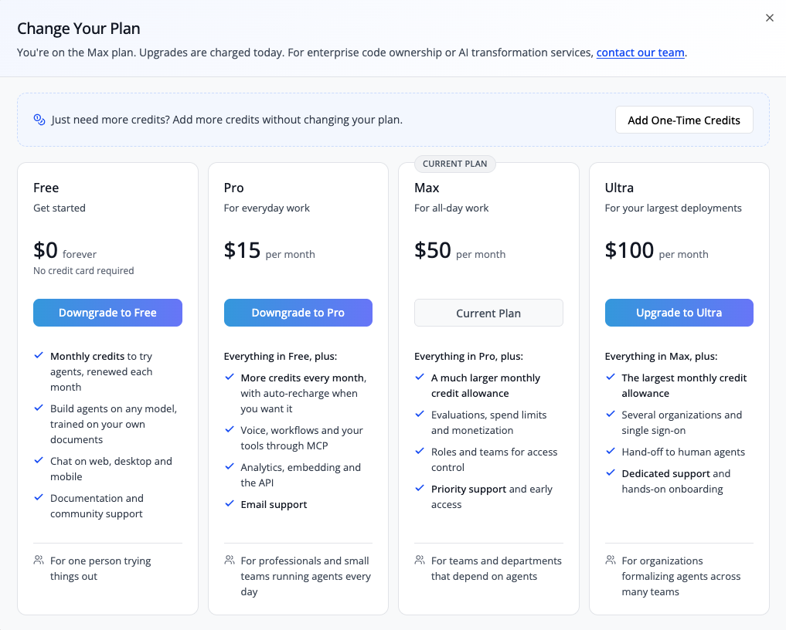

# /iblai-vibe-credit-exhaustion

What the app shows when the organization's ibl.ai credits are spent, and
before that, when a free-trial user reaches for something only a workspace
owner may do. The decision is the SDK's (`use402ErrorCheck` in
`@iblai/iblai-js/web-utils`); it only flips flags on the store. This skill is
where those flags become screens — the plan picker, the Billing page, a
contact-your-admin notice — for everything on the page: the in-process
`<Chat>`, the navbar widget, the app's own REST calls, and an OS agent
embedded with `<agent-ai>`. vibe-starter ships it.



> **Common setup (brand, conventions, env files, verification):** see [docs/skill-setup.md](https://raw.githubusercontent.com/iblai/vibe/refs/heads/main/docs/skill-setup.md).

## How the SDK decides

Every 402 (a chat message, a training run, any call the credits ledger
refuses) goes through `handle402Error`. It shows one toast, then opens the
one thing that person can do next:

| Who ran out | Toast | Next step |
|---|---|---|
| An **admin** of the organization | "You've run out of credits. Add credits to continue." | `openBillingTab` from `SubscriptionConfigProvider` — vibe-starter sends them to `/admin/billing` (`/iblai-vibe-billing`); the OS opens its profile modal on Billing (`?profileTab=billing`) |
| A **free-trial** user — signed up on the platform's main organization (`main`) and in no other (the backend sends a `pricing_table` only to the account owner; `useUserIsOnTrial` is the fallback) | "You've run out of your free trial credits. Pick a plan to continue." | `UpgradePackageModal` — **Choose Your Plan**: Free ($0, no card, their own workspace), Pro, Max, Ultra, with a "contact our team" line for enterprise |
| Everyone else (a **member**) | "Your organization has run out of credits." | `ContactAdminModal` — one line and a **Contact Now** button that mails the organization's support address |
| A desktop/iOS build that may not sell in-app (Apple's rules) | — | `AppleRestrictionModal` instead of any checkout |

The free trial lives on the platform's main organization (`main` on hosted
ibl.ai, the SDK's default `mainTenantKey`), the only one that lists and
changes plans. A single-organization app on its own organization has no
free-trial users: there, a non-admin gets the picker only when the 402
carries a `pricing_table`, and an organization already on a plan meets it as
**Change Plan** (the navbar widget, Billing).

Two more things read the same store: the **free-trial gate** (Step 3) sends a
trial user to the plan picker *before* an admin action instead of letting it
fail, and the **top banner** (`SubscriptionTopBanner`) carries the
"credits exhausted" line with its own button. Nothing here charges anyone —
plans and credits are bought on Stripe through the ibl.ai backend
(`/iblai-vibe-credit`, `/iblai-vibe-billing`).

## What you get

- `components/credit-exhaustion-handler.tsx` (`assets/`): renders
  `UpgradePackageModal`, `ContactAdminModal` and `AppleRestrictionModal` from
  the store, and listens for an embedded agent's `creditsexhausted` event.
  Mounted once in `app/(app)/layout.tsx`.
- `SubscriptionConfigProvider` in the provider chain, with the credits
  switch, support address, plan bullets and where Billing lives (the main
  organization stays the SDK's default: the platform's, not the app's); the
  `subscription`, `topBanner` and `appleRestriction` slices in the store.
- `config.stripeEnabled()` and `config.planFeatures()` in `lib/iblai/config.ts`
  from `NEXT_PUBLIC_STRIPE_ENABLED` and `NEXT_PUBLIC_PLAN_FEATURES_*`.
- `components/embedded-agent.tsx` (`assets/`, optional): the OS agent in an
  iframe with the hand-off turned on (live once the OS ships iblai/os#677).
- vibe-starter ships all of it but the embed; `/iblai-vibe-auth` installs the
  store and providers on an existing app.

## When to use / when not

| Use it for | Not for |
|---|---|
| Any app whose organization is billed in credits (every self-serve organization) | Charging *your* users — `/iblai-vibe-pricing` picks that rail |
| An OS agent embedded with `<agent-ai>` whose picker should open at page size | The in-process `<Chat>` alone: it already calls these flows; you still need Step 2 so its modals have somewhere to render |
| The navbar widget's Upgrade / Change Plan (`/iblai-vibe-credit`) and the Billing page (`/iblai-vibe-billing`) — same picker, same store | Spend caps (a `429`, not a `402`): `/iblai-vibe-agent-billing` |

## Prerequisites

- Auth in place (`/iblai-vibe-auth`, or vibe-starter).
- `@iblai/iblai-js@^2.85.1`: the credits flows, the plan picker and its
  bullets arrived in 2.73.0, the host side of the embed hand-off in 2.79.0.
  For the embed itself, `@iblai/agent-ai@^2.15.1` and the OS release that
  carries iblai/os#677 (Step 5).
- An organization on the credits model: the main organization's sign-up is
  a free trial; a workspace created from the picker is on a plan.

## Step 1: The store slices and the host config

The flows read the subscription status from the store and write the modal
flags to it. The reducer map needs these three keys, under exactly these
names (vibe-starter's `store/iblai-store.ts`):

```ts
reducer: {
  // … chat, chatInput, chatSliceShared, files, rbac, coreApiSlice, mentorReducer
  subscription: subscriptionReducer,
  topBanner: topBannerReducer,
  appleRestriction: appleRestrictionReducer,
}
```

Then tell the SDK about the app, once, above everything that renders
(vibe-starter does it inside `providers/iblai-providers.tsx`; on an app with
its own provider chain, wrap it):

```tsx
// providers/credits-config.tsx
"use client";

import { useMemo, type ReactNode } from "react";
import { useRouter } from "next/navigation";
import { SubscriptionConfigProvider } from "@iblai/iblai-js/web-utils";
import config from "@/lib/iblai/config";

export function CreditsConfig({ children }: { children: ReactNode }) {
  const router = useRouter();
  const value = useMemo(
    () => ({
      // No `mainTenantKey`: the SDK's default, `main`, is the platform's main
      // organization — not this app's (NEXT_PUBLIC_MAIN_TENANT_KEY).
      // The credits switch: off, and nothing gates or prompts for credits.
      stripeEnabled: config.stripeEnabled(),
      // Fallback for Contact Now when the organization's metadata has none.
      supportEmail: config.supportEmail(),
      // The plan picker's bullets, by plan key (Step 4).
      planFeatures: config.planFeatures(),
      // An admin who ran out of credits: this app's Billing page.
      openBillingTab: () => router.push("/admin/billing"),
    }),
    [router],
  );
  return <SubscriptionConfigProvider config={value}>{children}</SubscriptionConfigProvider>;
}
```

Every field has a default, so the hooks work without the provider: billing
on, `openBillingTab` pushing `?profileTab=billing` for the OS's profile
modal (set those), and `mainTenantKey: "main"`, the platform's main
organization — where free-trial users live and the only one that lists and
changes plans. Leave that one alone. It is not your app's organization: with
`NEXT_PUBLIC_MAIN_TENANT_KEY` in the slot, Change Plan is refused (404,
"Only the main platform offers plan changes"), every admin sees the credit
balance whether or not the organization sells credits, and the free-trial
gate sends every member to the picker. Read it back with
`useSubscriptionConfig().mainTenantKey` wherever a component takes
`mainPlatformKey`.

## Step 2: Mount the handler

Copy `assets/credit-exhaustion-handler.tsx` to
`components/credit-exhaustion-handler.tsx` and render it once inside the
signed-in layout, next to the navbar:

```tsx
// app/(app)/layout.tsx — inside the signed-in layout, beside the navbar
<NavBar … />
<NavigationDrawer … />
{/* The plan picker / contact-admin notice the SDK opens when credits run out. */}
<CreditExhaustionHandler />
```

What it does: `use402ErrorCheck()` gives it `handle402Error`; it renders the
three modals whenever `state.subscription.openPricingModal`,
`state.subscription.openContactAdminModal` or
`state.appleRestriction.openAppleRestrictionModal` is set; and it listens on
`document` for the `creditsexhausted` event (the providers below, Step 5),
dropping a repeat within a second — one REST 402 reaches the data layer's
handler twice. The picker's `mainPlatformKey` is the provider's
`mainTenantKey`, `sourcePlatformKey` the current organization, and its
`redirectUrl` the login page with the app nested inside
(`<auth>/login?app=custom&redirect-to=<origin>`): the checkout appends a
sign-in token the login page consumes before returning to the app, and the
pricing session refuses a return URL on a domain it does not allow, which an
app's own domain is not (400 "Redirect URL domain is not allowed"). That URL
is `loginReturnUrl()` in `lib/iblai/auth-utils.ts`; `/iblai-vibe-auth`
installs it, and an older copy of the file needs it added:

```ts
// lib/iblai/auth-utils.ts
import config from "@/lib/iblai/config";

/** The login page with this app nested inside: where a checkout returns the person. */
export function loginReturnUrl(origin: string = config.appUrl()): string {
  return `${config.authUrl()}/login?app=custom&redirect-to=${encodeURIComponent(origin)}`;
}
```

Then route the app's own REST 402s the same way. The data layer takes one
handler per status; vibe-starter's `providers/iblai-providers.tsx` passes
it to `initializeDataLayer`, dispatching the same event the handler already
listens for, so one component shows the next step:

```ts
// the httpErrorHandler argument of initializeDataLayer(...)
const httpErrorHandler = {
  402: (error?: unknown) => {
    // The data layer hands over the 402's body itself (spread) or, on its
    // legacy-LMS path, `{ status, body, message }`.
    const raw = (error ?? {}) as Record<string, unknown>;
    const body = (raw.body && typeof raw.body === "object" ? raw.body : raw) as Record<string, unknown>;
    // An item paywall's 402 (`has_access`, `pricing`) belongs to the
    // monetization flows; a credits 402 carries the backend's sentence.
    if ("has_access" in body || "item_type" in body || "pricing" in body) return;
    document.dispatchEvent(
      new CustomEvent("creditsexhausted", { detail: { type: "credits.exhausted", ...body } }),
    );
  },
};
```

`<Chat>` needs nothing more: its default `on402Error` is this same hook
(`navigateToAdminBilling` in its config is the admin's step), and now its
modals have a place to render. A host-owned dialog through
`config.freeTrialDialog` is no longer needed.

## Step 3: Gate admin actions for free-trial users

A free-trial user may chat; creating an agent, inviting people or opening
Management is for a workspace owner, so the OS offers them a plan first.
Wrap such actions in the SDK's gate. It runs the action when the person may
take it; otherwise it opens their next step and returns `null`:

```tsx
// components/new-agent-button.tsx
"use client";

import { useRouter } from "next/navigation";
import { useShowFreeTrialDialog } from "@iblai/iblai-js/web-utils";

export function NewAgentButton() {
  const router = useRouter();
  const { executeWithTrialCheck } = useShowFreeTrialDialog();
  return (
    <button
      type="button"
      className="ibl-button-primary inline-flex items-center rounded-lg px-4 py-2 text-sm font-medium"
      onClick={() => executeWithTrialCheck(() => router.push("/setup"))}
    >
      New agent
    </button>
  );
}
```

`executeWithTrialCheck(action, isAdminAction = true)`: pass `false` for
things every signed-in person may do (then only "credits exhausted" blocks
it). `isNewlyUserOnPreFreeOrAdvertisingMode(true)` is the predicate alone —
the OS and the LMS use it to *show* the whole admin menu to a trial user and
open the picker on click, instead of hiding the menu. `<Chat>` exposes the
same gate as `config.onUpgradeRequired`.

The predicate asks whether the current organization is the platform's main
one (or an advertising one) and the person is not its admin; it does not
count the person's organizations. On an app's own organization it is false
for everyone, so the gate blocks only on exhausted credits; on the main
organization it sends every non-admin to the picker.

## Step 4: The plan picker's bullets

Each card's bullets come from the host, so an app describes the plans in
its own words. `config.planFeatures()` reads four `|`-separated env
variables (`**text**` shows in bold); `premium` is the Pro plan's key. An
empty variable keeps the SDK's built-in bullets. vibe-starter's
`.env.example` carries the OS's:

```bash
NEXT_PUBLIC_STRIPE_ENABLED=true
NEXT_PUBLIC_PLAN_FEATURES_FREE="**Monthly credits** to try agents, renewed each month|Build agents on any model, trained on your own documents|Chat on web, desktop and mobile|Documentation and community support"
NEXT_PUBLIC_PLAN_FEATURES_PRO="**More credits every month**, with auto-recharge when you want it|Voice, workflows and your tools through MCP|Analytics, embedding and the API|**Email support**"
NEXT_PUBLIC_PLAN_FEATURES_MAX="**A much larger monthly credit allowance**|Evaluations, spend limits and monetization|Roles and teams for access control|**Priority support** and early access"
NEXT_PUBLIC_PLAN_FEATURES_ULTRA="**The largest monthly credit allowance**|Several organizations and single sign-on|Hand-off to human agents|**Dedicated support** and hands-on onboarding"
```

Names, taglines, prices and intervals are not yours to set: the backend
resolves them from the organization's Stripe payment links
(`GET …/stripe/pricing-page-session/` → `plans[]`). Keep the bullets
industry-neutral unless the app is for one audience — the LMS lists
courses and cohorts, the OS lists agents and workflows.

## Step 5: An embedded OS agent

> **Not live yet.** The OS sends the `credits.exhausted` frame only from
> iblai/os#677, which is still open: OS `main` posts nothing for a 402. Until
> that release the attribute is accepted and the embed keeps its own modals;
> wire it now and the hand-off starts when the OS ships.

When the agent on the page is the OS itself in an iframe (`<agent-ai>` from
`@iblai/agent-ai` — the OS's own chat, sidebar and settings, signed in as
your user), a 402 would open the picker inside the widget. The
`handlecreditexhaustion` attribute hands it to the page instead:

1. On load (and whenever the attribute changes) the element tells the agent
   `{ type: 'MENTOR:HANDLE_CREDIT_EXHAUSTION', data: true }`.
2. On a 402 the agent still shows its toast, but instead of a modal it posts
   `{ type: 'credits.exhausted', audience: 'admin' | 'trial' | 'user', error, message, pricing_table }`
   to the parent.
3. The element re-dispatches that frame as the `creditsexhausted` DOM event
   (`detail` is the frame; it bubbles and is composed) — the one the handler
   from Step 2 listens for — which feeds it to the host's `handle402Error`:
   same routing, at page size.

Copy `assets/embedded-agent.tsx` to `components/embedded-agent.tsx`:

```tsx
// components/embedded-agent.tsx — the element, with the hand-off on
"use client";

import { createElement, useEffect, useState } from "react";
import config from "@/lib/iblai/config";
import { resolveAppTenant } from "@/lib/iblai/tenant";

export function EmbeddedAgent({ agentId }: { agentId: string }) {
  const [ready, setReady] = useState(false);
  useEffect(() => {
    let active = true;
    // Registers <agent-ai>; a browser-only module, never at import time.
    void import("@iblai/agent-ai").then(() => {
      if (active) setReady(true);
    });
    return () => {
      active = false;
    };
  }, []);
  if (!ready) return null;
  return createElement("agent-ai", {
    authurl: config.authUrl(),
    lmsurl: config.legacyLmsUrl(),
    tenant: resolveAppTenant(),
    mentor: agentId,
    authRelyOnHost: true,       // signed in as this app's user
    handleCreditExhaustion: true, // the 402's next step opens here, not in the widget (from the OS release with iblai/os#677)
    theme: "light",
    style: { display: "block", width: "100%", height: "100%" },
  });
}
```

`authRelyOnHost` makes the embed use the session this app's SSO stored and
never redirect to the login page on its own. Self-hosting the OS? Add
`mentorurl` with its origin. The raw `postMessage` reaches `window` too, for
a host without a handle on the element. The wire contract is in
`/iblai-api-agent-embed` (references, §5).

## Verify

1. `pnpm build` and `pnpm test` pass; `pnpm e2e:coverage` lists the
   checkpoint below.
2. Touch test as `/iblai-vibe-ops-test` says, signed in as an admin: in the
   browser console run
   `document.dispatchEvent(new CustomEvent('creditsexhausted', { detail: { type: 'credits.exhausted', audience: 'admin' } }))`
   — a toast, then `/admin/billing`. Signed in as a member of the same
   organization: the "Your organization has run out of credits" dialog, and
   **Contact Now** opens a mail draft. A user who signed up moments ago (a
   free trial, on the platform's main organization): the "Choose Your Plan"
   dialog with four cards and your bullets; console clean; no sideways
   scroll at phone width.
3. The real thing needs an organization with no credits left (ask an ibl.ai
   operator to zero a test organization's balance): send a chat message —
   the same screens, from a real 402. vibe-starter's checkpoints dispatch
   the event by hand so the suite never spends credits: K10 (the admin lands
   on Billing, `e2e/journeys/pages.journey.spec.ts`), M6 (a member gets the
   notice) and M7 (a `pricing_table` opens the picker; both in
   `member.journey.spec.ts`).

## Customize

```
get_component_info("UpgradePackageModal")
get_component_info("ContactAdminModal")
get_hook_info("use402ErrorCheck")
get_hook_info("useShowFreeTrialDialog")
```

`<UpgradePackageModal>` — `@iblai/iblai-js/web-containers`:

| Prop | Type | Description |
|---|---|---|
| `open`, `onClose` | `boolean`, `() => void` | The dialog's state (vibe-starter binds `state.subscription.openPricingModal`) |
| `redirectUrl` | `string` | Where Stripe sends the person back after checkout: the login page with the app's origin nested (`loginReturnUrl()`); the pricing session refuses a domain it does not allow |
| `sourcePlatformKey`, `mainPlatformKey` | `string` | The current organization and the platform's main one (`useSubscriptionConfig().mainTenantKey`) |
| `currentUserEmail` | `string` | Pre-fills Stripe Checkout |
| `currentPlanKey` | `string \| null` | Change mode: that card reads "Current Plan", the others offer an upgrade or a downgrade. Leave unset for a free-trial user |
| `planFeatures` | `Record<string, string[]>` | Bullets by plan key; defaults to the provider's (Step 4) |
| `enterpriseContactUrl` | `string` | The "contact our team" link (default `https://ibl.ai/contact`; `""` drops the sentence) |
| `onPlanChanged` | `(result) => void` | Change mode: after `updated` / `scheduled` — refetch the billing info |
| `onAddCredits` | `() => void` | Change mode: shows "Add One-Time Credits" under the plans |
| `checkoutUrl`, `ctaLabel`, `features`, `footerNote`, `title`, `description` | `string`, `string[]` | One checkout link instead of the platform's plans — an app's direct join URL |

`<ContactAdminModal>` and `<AppleRestrictionModal>` take `isOpen` and
`onClose`. `SubscriptionConfig`: `mainTenantKey`, `platformName`,
`mentorUrl`, `stripeEnabled`, `supportEmail`, `openBillingTab`,
`planFeatures` — all optional, all defaulted.

## Platform data

| Hook / call | Purpose |
|---|---|
| `use402ErrorCheck({ navigateToAdminBilling? })` → `handle402Error(body)` | The routing above; `body` is the 402's `{ error, message, pricing_table }` |
| `useShowFreeTrialDialog()` → `executeWithTrialCheck`, `isNewlyUserOnPreFreeOrAdvertisingMode` | The free-trial gate |
| `useUserIsOnTrial()`, `useIsStripeActivated()` | One organization, the main one, not its admin, billing on; the credits switch for the current organization |
| `useSubscriptionConfig()` | The provider's values (or the defaults) |
| `useStripeUpgrade({ … })` → `plans`, `loadPlans`, `choosePlan`, `changePlan` | What the picker calls; `STRIPE_PLAN_KEYS` = `free`, `premium` (Pro), `max`, `ultra` |
| `setOpenPricingModal`, `setOpenContactAdminModal`, `setOpenAppleRestrictionModal` | The flags the handler renders from |
| `useGetAccountBillingInfoQuery` | `plan_key` / `plan_name` (absent on a trial), credits, auto-recharge |
| `useGetStripePricingPageSessionQuery`, `useChangeStripePlanMutation` | `GET …/service/platforms/{org}/stripe/pricing-page-session/` (the `plans` list); `POST …/stripe/plans/change/` `{ plan_key }` → `updated` / `scheduled` / `checkout` |
| The 402 itself (REST only) | `{ "error": "…", "message"?: "…", "pricing_table"?: { pricing_table_id, publishable_key, client_reference_id } }` — `pricing_table` only for the account owner on a trial |

All hooks from `@iblai/iblai-js/web-utils`, the queries from
`@iblai/iblai-js/data-layer`. REST reference:
[`/iblai-api-billing`](https://raw.githubusercontent.com/iblai/vibe/refs/heads/main/skills/billing/iblai-api-billing/SKILL.md).

## Important Notes

- **Billing off** (`NEXT_PUBLIC_STRIPE_ENABLED=false`): no navbar widget, no
  trial gate, no plan picker from the widget. A 402 still toasts and routes
  (an admin to Billing, a member to the contact-admin notice) — the ledger
  does not know the switch.
- **Who is an admin**: `is_admin` on the current organization in the
  signed-in user's `tenants`, not your app's Admin/User switch. An admin
  browsing in User mode is still sent to Billing; vibe-starter's `/admin/*`
  is Admin-mode-only, so they land on the home page — open Billing from
  Admin mode.
- **The main organization is the platform's, not yours**: `mainPlatformKey`
  everywhere (the picker, `CreditBalance`, `BillingTab`, the navbar rule) is
  `useSubscriptionConfig().mainTenantKey`, never `NEXT_PUBLIC_MAIN_TENANT_KEY`
  (Step 1 says what goes wrong).
- **One place to render**: the modals read the store, so a second
  `CreditExhaustionHandler` (or the OS's own `ModalContainer` pattern beside
  it) would open twice. Mount it once, in the layout.
- **Spend caps are not credits**: a blocked spend limit is a `429` with
  `spend_cap_exceeded`, handled by `<Chat>` itself (`/iblai-vibe-agent-billing`).
- **Brand guidelines**: [BRAND.md](https://raw.githubusercontent.com/iblai/vibe/refs/heads/main/BRAND.md)

## Related skills

- `/iblai-vibe-credit` — the navbar widget: Upgrade / Change Plan / Add Credits
- `/iblai-vibe-billing` — the Billing page an admin lands on
- `/iblai-vibe-pricing` — how the organization is charged; charging your users
- `/iblai-vibe-agent-chat` — `on402Error`, `onUpgradeRequired` on `<Chat>`
- `/iblai-api-agent-embed` — the embed's wire contract, including the credits frames
- `/iblai-vibe-ops-build` — the Apple in-app-purchase restriction on native builds
