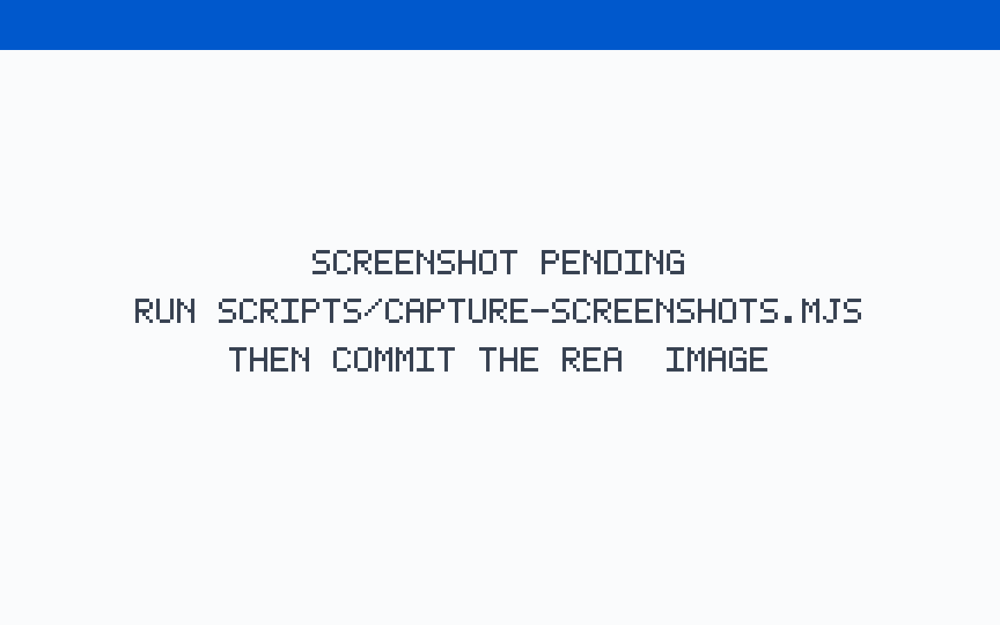
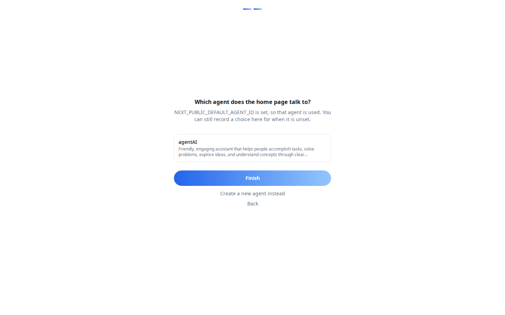
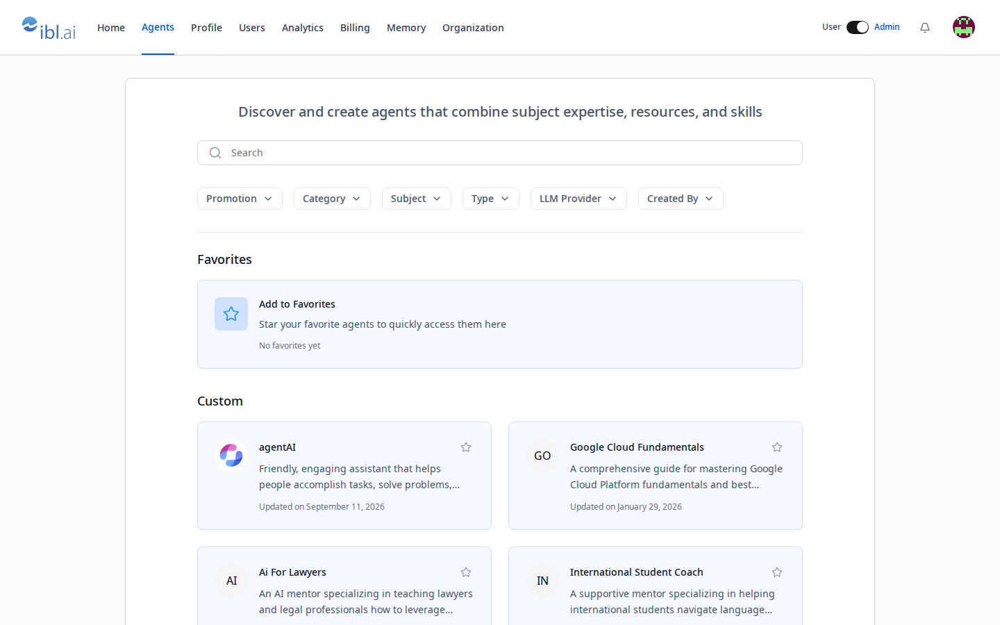
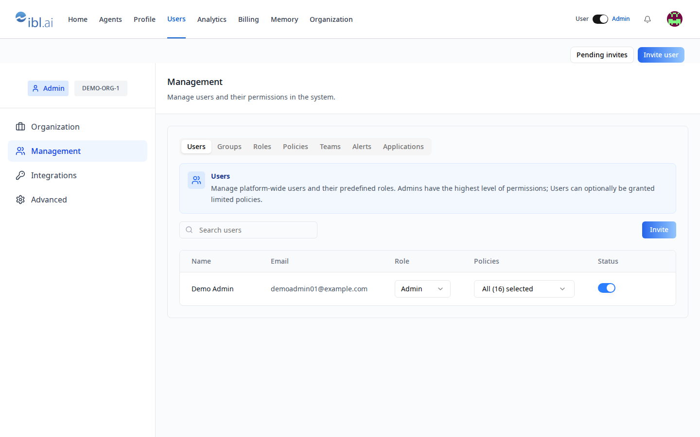
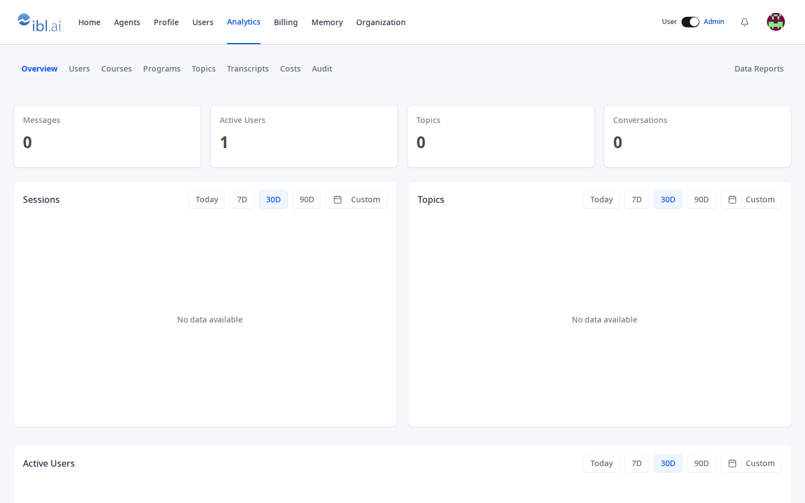
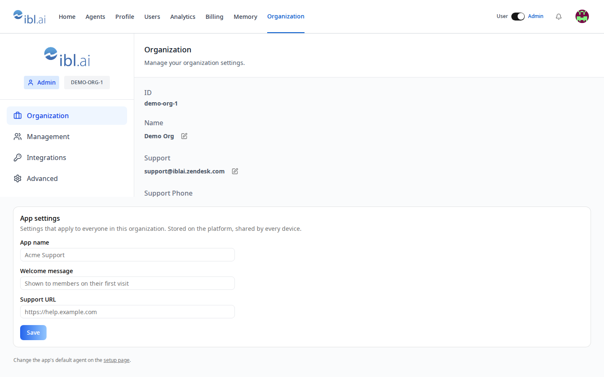
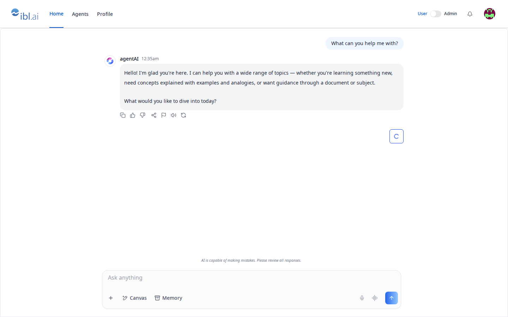
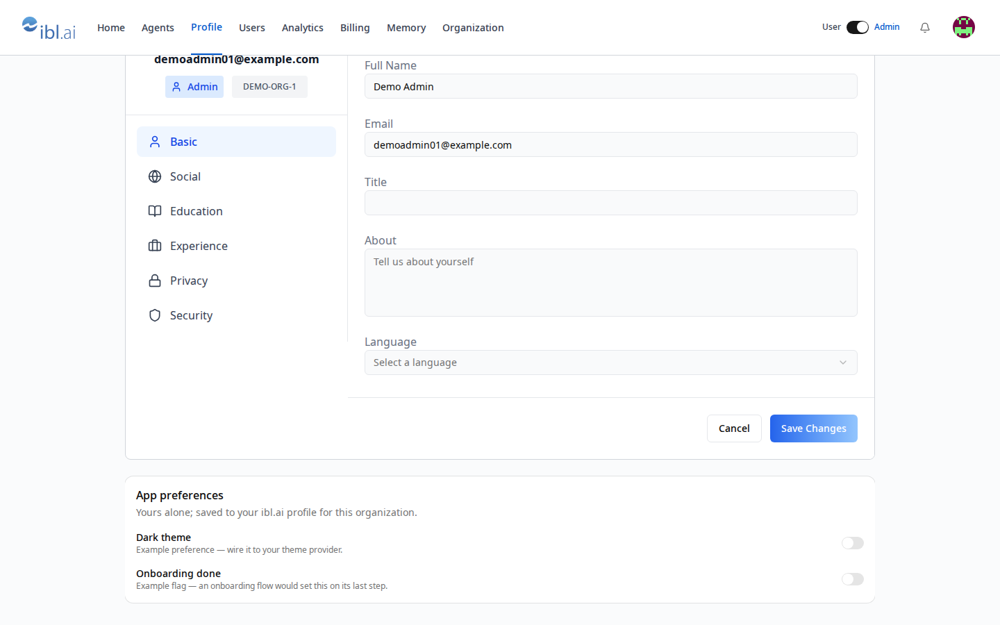

<div align="center">

<a href="https://ibl.ai"></a>

# Vibe Starter

**The app you actually need on ibl.ai — ready to make yours.**

Sign-in, an agent to talk to, users and admins, custom user and organization data, memory, analytics, billing: a pre-wired Next.js 16 + Tailwind v4 + shadcn/ui project with the [`@iblai/iblai-js`](https://www.npmjs.com/package/@iblai/iblai-js) SDK already integrated, scaffolded by the `/iblai-vibe-ops-init` skill of [iblai/vibe](https://github.com/iblai/vibe). One codebase. Every platform. Your app, on your organization's data.

[](https://ibl.ai/join)
[](https://ibl.ai)
[](https://ibl.ai/docs)
[](#license)
[](https://ibl.ai)
[](https://nextjs.org)
[](https://www.typescriptlang.org)
[](https://tailwindcss.com)
[](https://claude.ai)
[](https://github.com/iblai/vibe/blob/main/skills/ship/iblai-vibe-ops-build/SKILL.md)

<br>

[Why Vibe Starter](#why-vibe-starter) · [Every platform](#every-platform-one-codebase) · [Features](#features) · [Case studies](#case-studies) · [Screenshots](#screenshots) · [Quick Start](#quick-start) · [Deployment](#deployment) · [Architecture](#architecture)

</div>

> **Note:** This starter runs against the hosted [iblai.app](https://iblai.app) environment. If you'd like a license to the full platform codebase to run locally or self-host, reach out to our team at [ibl.ai/contact](https://ibl.ai/contact).

---

<div align="center">

**SOC 2 Type II** &nbsp;·&nbsp; Universities, enterprises, and governments run on ibl.ai — [read the case studies →](https://ibl.ai/case-studies)

</div>

---

## Why Vibe Starter

|                                 |                                                                                                                                                                                                             |
| ------------------------------- | ----------------------------------------------------------------------------------------------------------------------------------------------------------------------------------------------------------- |
| 🚀 **Minutes, not days**        | Auth, navbar and the standard ibl.ai pages are already wired. Skip the manual `/iblai-vibe-auth`, `/iblai-vibe-navbar`, `/iblai-vibe-profile`, `/iblai-vibe-account` and `/iblai-vibe-notification` skills. |
| 🧠 **Backend included**         | Connects to [iblai.app](https://iblai.app) for SSO auth, AI agent infrastructure, analytics and organization management.                                                                                    |
| 🔐 **Client-side auth via SSO** | End users never handle tokens; the one Platform API Token you hold stays server-side in `iblai.env`.                                                                                                        |
| 🤖 **Skills guide every step**  | With Claude Code skills, adding a feature is a conversation, not a scavenger hunt through docs.                                                                                                             |
| 🎨 **shadcn/ui fills the gaps** | Consistent design language without the overhead of a custom design system.                                                                                                                                  |
| 📱 **Ship everywhere**          | Web (Vercel), desktop (macOS/Windows/Linux) and mobile (iOS/Android) via Tauri v2.                                                                                                                          |

---

## Every platform, one codebase

Vibe Starter meets your users wherever they are — the same app, native everywhere.

<div align="center">

| Platform    |     | Status                                                                                 |
| ----------- | --- | -------------------------------------------------------------------------------------- |
| **Web**     | 🌐  | Any modern browser — ship it with `/iblai-vibe-ops-deploy`                             |
| **macOS**   | 🍎  | Native app — the Tauri 2 shell `/iblai-vibe-ops-build` adds                            |
| **Windows** | 🪟  | Native app — the Tauri 2 shell `/iblai-vibe-ops-build` adds                            |
| **Linux**   | 🐧  | Native app — the Tauri 2 shell `/iblai-vibe-ops-build` adds                            |
| **iOS**     | 📱  | Native app — `/iblai-vibe-ops-build`, then `/iblai-vibe-ops-release` for the App Store |
| **Android** | 🤖  | Native app — `/iblai-vibe-ops-build`, then `/iblai-vibe-ops-release` for Google Play   |

</div>

SSO authentication, the AI chat, the user profile, account settings, the analytics dashboard, notifications, the credit balance and the admin area work on every surface.

> **iOS & Android SSO:** mobile WebViews are rejected by SSO providers, so the Tauri shell opens sign-in in the system browser (ASWebAuthenticationSession on iOS, Chrome Custom Tabs on Android) and returns through a deep link. Set `TAURI_CUSTOM_SCHEME` in `iblai.env` — see [`/iblai-vibe-ops-build`](https://github.com/iblai/vibe/blob/main/skills/ship/iblai-vibe-ops-build/SKILL.md) “Mobile SSO”.

---

## Features

<table>
<tr>
<td width="50%" valign="top">

**🤖 Build**

- **Home = chat** — `/` is the SDK `<Chat>` with the app's agent (`?agent=` → `NEXT_PUBLIC_DEFAULT_AGENT_ID` → the organization setting saved on `/setup`); an honest "No agent yet" state otherwise
- **Agents** — `/agents`, the SDK `AgentSearch` (favorites, featured, custom, all); a card opens the chat
- **First-run setup** — `/setup`: admins name the app and pick or create its agent (a server route with the organization's authority); saved to organization metadata
- **Custom data on the platform** — `useUserSettings` (per user × organization) and `useOrgSettings` (per organization, GET-merge-PUT) in `lib/iblai/metadata.ts`; example cards on `/profile` and `/admin/organization`; an admin route for other users' data
- **Server helper** — `lib/iblai/platform.ts`: `platformFetch` (Api-Token), `verifyCaller`, `requireAdmin` for any REST call without a component
- **Next.js 16** — App Router, TypeScript, Tailwind v4, shadcn/ui (new-york, theme-mapped to ibl.ai brand colors)

</td>
<td width="50%" valign="top">

**🏢 Operate & scale**

- **SSO sign-in** — `AuthProvider`, the SSO callback, the storage service, the Redux store, organization resolution; a placeholder or `main` organization renders an alert instead of a login loop
- **User / Admin mode** — organization admins get a navbar switch to view the app exactly as a member; admin links and `/admin/*` exist only in Admin mode
- **Admin area** — `/admin/users` (Users · Groups · Roles · Policies · Teams · Alerts + invitations), `/admin/analytics/*` (SDK tabs), `/admin/billing`, `/admin/memory`, `/admin/organization` (+ the app settings form)
- **Profile · Account · Notifications** — `/profile` (SDK `Profile` + app preferences), `/account` (SDK `Account`), `/notifications/[[...id]]` (SDK `NotificationDisplay`)
- **Four languages** — English, Spanish, French and Chinese, following the language chosen in any other ibl.ai app
- **Tests** — Vitest (config, organization, metadata, platform helper) and Playwright journeys (auth, member, admin, pages, api, mobile) with `e2e/COVERAGE.md` and `pnpm e2e:coverage`
- **Mobile safe areas** — `globals.css` insets, `viewport-fit=cover` and an app shell sized to the safe area, wired for iOS/Android (Tauri v2 ready)

</td>
</tr>
</table>

---

## Adding Features

Any ibl.ai skill works out of the box. The ones this starter already uses are marked ✓:

```text
/iblai-vibe-agent-chat      ✓ customize the chat on /
/iblai-vibe-agent-search    ✓ /agents
/iblai-vibe-agent-create    ✓ /setup + /api/admin/agents
/iblai-vibe-agent           # configure an agent (26 tabs, one provider)
/iblai-vibe-user-metadata   ✓ per-user settings
/iblai-vibe-org-metadata    ✓ per-org settings
/iblai-vibe-admin           ✓ User/Admin mode + admin area
/iblai-vibe-invite          ✓ on /admin/users
/iblai-vibe-analytics       ✓ /admin/analytics
/iblai-vibe-billing         ✓ /admin/billing
/iblai-vibe-memory          ✓ /admin/memory
/iblai-vibe-memory-guide    # what memory means for your app
/iblai-vibe-pricing         # how money works; charge your users
/iblai-vibe-credit          ✓ credit widget in the navbar (paywall-enabled orgs)
/iblai-vibe-api             ✓ lib/iblai/platform.ts — REST without a component
/iblai-vibe-onboard         # onboarding questionnaire flow
/iblai-vibe-ops-deploy      # ship to a URL
/iblai-vibe-ops-build       # macOS, Windows, iOS, Android
/iblai-vibe-ops-release     # App Store / Google Play
/iblai-vibe-ops-test        # test before showing work
/iblai-vibe-ops-upgrade     # upgrade SDK and skills
```

See `AGENTS.md` (also `CLAUDE.md`) for the "what the user says → which skill" table.

---

## Case studies

Universities, enterprises, and government agencies build on ibl.ai — deploying agents on their own infrastructure, with their own models, at a fraction of the cost of closed platforms.

**[Read the case studies →](https://ibl.ai/case-studies)**

---

## Screenshots

<div align="center">



<sub>**Home** — the SDK Chat with the app's agent</sub>

<br><br>

<table>
<tr>
<td width="50%"><br><sub><b>First-run setup</b> — admins name the app and pick or create its agent</sub></td>
<td width="50%"><br><sub><b>Agents</b> — the SDK AgentSearch</sub></td>
</tr>
<tr>
<td width="50%"><br><sub><b>Admin area</b> — users and invitations</sub></td>
<td width="50%"><br><sub><b>Analytics</b> — the SDK dashboards</sub></td>
</tr>
<tr>
<td width="50%"><br><sub><b>Organization</b> — the app settings form</sub></td>
<td width="50%"><br><sub><b>User mode</b> — the app exactly as a member sees it</sub></td>
</tr>
</table>

<br>



<sub>**Profile** — the SDK Profile with the app's preferences</sub>

</div>

---

## Quick Start

This project was scaffolded from the vibe-starter template bundled with [iblai/vibe](https://github.com/iblai/vibe) (the `/iblai-vibe-ops-init` skill).

```bash
cp .env.example .env.local
pnpm install --ignore-scripts
pnpm dev
```

> Always run `pnpm install` with `--ignore-scripts` to skip package lifecycle (postinstall) scripts.

**Using [Claude Code](https://claude.ai/claude-code)?** Read [`AGENTS.md`](AGENTS.md) (also `CLAUDE.md`) first — the "what the user says → which skill" table and the platform's rules; `.claude/settings.json` pre-approves the MCP servers once you trust the folder.

**Manual setup:** copy `.env.example` to `.env.local` and set `NEXT_PUBLIC_MAIN_TENANT_KEY` — the API/auth/websocket URLs default to hosted iblai.app in `lib/iblai/config.ts`, so the organization key (and optionally `IBLAI_API_KEY`) is all `.env.local` needs.

Open [http://localhost:3000](http://localhost:3000). Unauthenticated users are redirected to `https://login.iblai.app` and returned with a session. The first admin to sign in lands on `/setup` to name the app and pick or create its agent. Every origin the app runs on (localhost, the deployed URL) must be in the organization's allowed redirect origins, or sign-in never comes back — see [platform-lifecycle.md](https://github.com/iblai/vibe/blob/main/docs/platform-lifecycle.md).

### Scripts

| Command             | What it does                                                                                           |
| ------------------- | ------------------------------------------------------------------------------------------------------ |
| `pnpm dev`          | Dev server (localhost:3000)                                                                            |
| `pnpm build`        | Production build                                                                                       |
| `pnpm start`        | Serve the production build                                                                             |
| `pnpm typecheck`    | TypeScript                                                                                             |
| `pnpm lint`         | oxlint                                                                                                 |
| `pnpm test`         | Vitest                                                                                                 |
| `pnpm test:e2e`     | Playwright journeys: Chrome desktop and a phone viewport (`pnpm test:e2e:all` adds Firefox and WebKit) |
| `pnpm e2e:accounts` | Creates the two test accounts ahead of time                                                            |
| `pnpm e2e:coverage` | Approximate e2e coverage from the journeys (≥ 95%)                                                     |

---

## Deployment

### ibl.ai hosting (Vercel) — recommended

Run `/iblai-vibe-ops-deploy` — zips the app, uploads it to the ibl.ai platform's hosting API using your platform API key (no Vercel account or token), polls until the build is READY, and writes the URL into `tauri.conf.json` (`build.frontendDist`) for the native builds. The app lands on the address the API reports.

### Tauri (desktop & mobile)

Add the Tauri shell with `/iblai-vibe-ops-build`, then:

```bash
pnpm exec tauri dev           # Dev mode
pnpm exec tauri build         # Desktop build for current platform
bash scripts/mobile-init.sh   # iOS on a Mac, Android on Linux; commit src-tauri/gen/
```

---

## Architecture

```
app/
  (app)/                          # Signed-in pages (navbar + drawer + User/Admin mode)
    layout.tsx                    # Session, AdminModeProvider, member vs admin links, /admin gate
    page.tsx                      # Home: SDK <Chat> with the app's agent (+ empty state)
    agents/page.tsx               # SDK <AgentSearch>
    profile/page.tsx              # SDK <Profile> + AppPreferences
    account/page.tsx              # SDK <Account>
    notifications/[[...id]]/      # SDK <NotificationDisplay>
    admin/                        # Admin mode only
      users/  analytics/  billing/  memory/  organization/
  setup/page.tsx                  # First-run (admins): app name, pick/create agent
  api/admin/                      # agents (list/create), user-metadata (other users)
  sso-login-complete/             # SSO callback (outside the route group)
  layout.tsx                      # Root layout — <IblaiProviders>
components/
  navbar/                         # nav-bar, navigation-drawer, logo, user-profile-button, admin-mode-switch
  admin/                          # account-panel (SDK Account by tab), analytics-page
  settings/                       # app-preferences (user), org-settings (org)
  setup/                          # setup-screen
  ui/                             # shadcn/ui
lib/iblai/                        # config, storage-service, auth-utils, tenant, admin-mode, metadata(-core), platform, admin-client
providers/iblai-providers.tsx     # Redux + Auth + Tenant + service worker + toaster
store/iblai-store.ts              # RTK store (slice keys fixed by the SDK)
public/sw.js                      # Offline service worker the SDK <Chat> registers
e2e/                              # Playwright journeys, COVERAGE.md + coverage.json, coverage.mjs (pnpm e2e:coverage)
.env.example                      # → .env.local: org key, IBLAI_API_KEY, optional agent/app name
iblai.env.example                 # → iblai.env: DOMAIN, PLATFORM, TOKEN
.mcp.json                         # @iblai/mcp (SDK docs) + chrome-devtools (the touch-test browser)
.claude/settings.json             # Pre-approves those servers in Claude Code (once you trust the folder)
.cursor/mcp.json, .codex/config.toml, opencode.json   # The same servers for Cursor, Codex and opencode
```

### Languages

Ships in English, Spanish, French and Chinese (Simplified). The locale is
resolved per request from cookies — the shared platform preference
(`openedx-language-preference`, set on the parent domain so a language chosen in
any ibl.ai app carries across) first, then this app’s own `NEXT_LOCALE`. There
is no `[locale]` route segment and no locale middleware, so routes are
unaffected, and `<html lang>` follows the resolved locale.

```
i18n/config.ts     supported locales, labels, resolveLocale()
i18n/request.ts    next-intl request config (cookie → messages)
messages/en.json   catalogs, one namespace per surface
messages/es.json
messages/fr.json
messages/zh.json
```

**Translating a surface**

1. Add the strings to every file in `messages/` under a namespace.
2. `const t = useTranslations('<Namespace>')` in the client component, and add
   `t` to any `useMemo`/`useCallback` dependency array that closes over it.
3. For a module-level table that cannot call hooks, store message **keys** and
   resolve them at render — see `MEMBER_LINKS` in `app/(app)/layout.tsx`.

**Adding a locale**

Add it to `SUPPORTED_LOCALES` and `LOCALE_LABELS` in `i18n/config.ts`, then add
`messages/<locale>.json` with the same keys. `iblai/os` ships a
`scripts/validate-i18n.mjs` that fails CI when catalogs drift out of parity —
worth copying.

### AI-assisted development

The starter ships with a curated `CLAUDE.md`/`AGENTS.md` so Claude Code (and any other agent that reads them) gets deep knowledge of the ibl.ai platform from the first prompt. `.mcp.json` ships the [@iblai/mcp](https://www.npmjs.com/package/@iblai/mcp) server for component-level lookups and the `chrome-devtools` server that `/iblai-vibe-ops-test` drives for the touch test. `.claude/settings.json` pre-approves them, so Claude Code asks nothing once you trust the folder; `.cursor/mcp.json`, `.codex/config.toml` and `opencode.json` carry the same servers for Cursor, Codex and opencode.

The [@iblai/mcp](https://www.npmjs.com/package/@iblai/mcp) server gives your AI assistant access to:

```
get_component_info("ChatWidget")              # Props, usage, examples for any component
get_hook_info("useAdvancedChat")              # Hook parameters and return types
get_api_query_info("useGetUserMetadataQuery") # RTK Query endpoint details
get_provider_setup("auth")                    # Provider hierarchy and setup code
create_page_template("Dashboard", "mentor")   # Generate a page following ibl.ai patterns
```

### Brand

- **Primary**: `#0058cc`
- **Gradient**: `linear-gradient(135deg, #00b0ef, #0058cc)`
- **Style**: shadcn/ui new-york, system sans-serif, Lucide icons

SDK and shadcn components share the same Tailwind theme and render in ibl.ai brand colors automatically — do not override them.

---

## Testing

This starter is covered by Vitest unit tests in `__tests__/` and Playwright end-to-end journeys in [`e2e/`](e2e/). **Run the journeys for any change** so nothing regresses:

| Command             | What it does                                                                                                                                                |
| ------------------- | ----------------------------------------------------------------------------------------------------------------------------------------------------------- |
| `pnpm test`         | Vitest — config, organization, metadata, platform helper                                                                                                    |
| `pnpm test:e2e`     | Playwright journeys (auth, member, admin, pages, api, mobile): Chrome desktop and a phone viewport against the server you run on :3000                      |
| `pnpm test:e2e:all` | The same journeys plus Firefox and WebKit                                                                                                                   |
| `pnpm e2e:accounts` | Creates the two test accounts ahead of time (`pnpm test:e2e` creates them when they are missing)                                                            |
| `pnpm e2e:coverage` | Checks `e2e/coverage.json` against the specs and the app and approximates coverage from the pages the journeys visit; under 95% it fails and names the gaps |

See [e2e/COVERAGE.md](e2e/COVERAGE.md) for current coverage. Coverage must not regress — add or update a journey whenever you change user-facing behavior.

The journeys sign in as two test accounts — an organization admin and a member in the organization `iblai.env` names, made with the `IBLAI_API_KEY` in `.env.local` once the platform confirms the two belong together — saving their credentials in the gitignored `e2e/.env.development`.

---

## Contributing

Contributions to the starter go to [iblai/vibe](https://github.com/iblai/vibe) (`skills/start/iblai-vibe-ops-init/assets/vibe-starter`). If you'll be working with AI-assisted tooling, read [`AGENTS.md`](AGENTS.md) first — it documents the platform's rules and which skill answers what the user says.

---

## Resources

- [Documentation](https://ibl.ai/docs)
- [Vibe](https://github.com/iblai/vibe) — the full developer toolkit and skill source
- [@iblai/iblai-js](https://www.npmjs.com/package/@iblai/iblai-js) — unified SDK for data, UI components, and auth utilities
- [@iblai/iblai-api](https://www.npmjs.com/package/@iblai/iblai-api) — auto-generated API types
- [@iblai/mcp](https://www.npmjs.com/package/@iblai/mcp) — MCP server for AI-assisted development
- [skills.sh/iblai/vibe](https://skills.sh/iblai/vibe) — install skills with `npx skills add iblai/vibe --all`

---

<div align="center">

## License

MIT — [ibl.ai](https://ibl.ai)

<br>

**[ibl.ai](https://ibl.ai)** · Your organization's AI, under your control.

</div>
